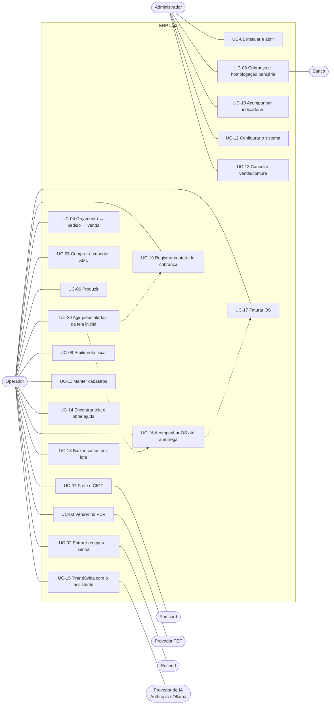

# 03 — Casos de uso

| | |
|---|---|
| **Documento** | Especificação de casos de uso |
| **Sistema** | ERP Loja 1.5.0 |
| **Atores** | Administrador, Operador (usuário comum), Cliente (OS e cobrança, fora do sistema), Banco, Administradora de CIOT (Pamcard), Provedor TEF, Resend, Provedor de IA (API da Anthropic ou Ollama local), Fornecedor (XML) |

---

## UC-01 — Instalar e abrir o sistema
- **Ator**: Administrador. **Pré-condição**: Windows 10/11 x64.
- **Fluxo principal**
  1. O ator copia `ErpLoja.exe` para uma pasta e o executa.
  2. O sistema localiza o banco (RN-BD-01), aplica migrações pendentes com backup (RN-BD-02/03) e faz o backup diário (RN-BD-04).
  3. O sistema exibe a tela de acesso.
- **Fluxos alternativos**
  - 2a. Banco não encontrado: o sistema exibe as opções *Criar banco novo* (ao lado do executável ou em pasta escolhida) e *Indicar arquivo* (validado como banco do sistema). O caminho fica lembrado.
  - 2b. Banco de versão mais nova que o executável: o sistema recusa e orienta a atualizar o executável.
  - 2c. Falha numa migração: a migração é desfeita; o sistema informa o backup e volta à escolha do banco.
- **Pós-condição**: banco na versão do sistema e lembrado para a próxima abertura.

## UC-02 — Entrar e recuperar a senha
- **Fluxo principal**: informar username e senha (RN-USU-01) → janela principal. Sem e-mail cadastrado, o sistema avisa (RN-USU-03).
- **Alternativo — Esqueci minha senha**
  1. O ator informa username ou e-mail e pede o código.
  2. O sistema gera o código, grava o hash e envia pelo Resend (RN-USU-06), mostrando o e-mail mascarado.
  3. O ator informa código e nova senha; o sistema confere validade, tentativas e grava a senha.
  - 2a. Envio não configurado / domínio não verificado / sem internet: mensagem específica ([10](10-falhas-e-resolucoes.md)).
  - 3a. Código errado: decrementa tentativas; na 5ª o código é invalidado. Código expirado: solicitar outro.

## UC-03 — Vender no PDV
- **Ator**: Operador. **Pré-condição**: produtos cadastrados.
- **Fluxo principal**
  1. O ator lê o código de barras / digita o código (ou `N*código`) e tecla Enter; o sistema lança o item, atualiza o último item e o total (RN-VEN-01/04).
  2. Opcionalmente: F2 cliente, F4 quantidade, F5 desconto (RN-VEN-02), F6 remover item.
  3. F10: o ator escolhe a forma de pagamento (1–5) e confirma.
  4. Cartão/PIX com TEF ativo: o sistema aciona o provedor; aprovada, fica pendente (RN-TEF-02).
  5. O sistema grava a venda (estoque, contas), confirma o TEF e imprime conforme parâmetros (RN-VEN-11, RN-TEF-05).
- **Alternativos**
  - 1a. Estoque insuficiente: perguntar/permitir/bloquear (RN-VEN-03).
  - 3a. A prazo sem cliente: o sistema pede o cliente. Limite de crédito excedido: só administrador (RN-VEN-08).
  - 4a. Transação negada/cancelada: volta ao PDV sem gravar.
  - 5a. Falha ao gravar: a transação TEF é desfeita. Falha de impressão: venda mantida, aviso exibido.

## UC-04 — Orçamento → pedido → venda
1. O ator cria o orçamento (itens, descontos, frete, condição, validade) e imprime.
2. Aprovado pelo cliente, o ator aprova: o sistema gera o pedido de venda (RN-PED-03).
3. O ator fatura o pedido (ou "Salvar e faturar"): o sistema confere estoque, pergunta a condição de pagamento e gera a venda (RN-PED-04), oferecendo emitir a nota (UC-09).
- **Alternativos**: recusar/cancelar orçamento; orçamento vencido aprovado com confirmação; cancelar a venda reabre o pedido (RN-VEN-10).

## UC-05 — Comprar e importar XML
- **Pedido de compra**: criar → receber mercadoria (forma, parcelas, NF) → estoque, custo médio com rateio (RN-CUS-04) e contas a pagar. "Salvar e receber" faz a entrada imediata.
- **XML**: selecionar o arquivo → o sistema lê, recusa duplicidade, localiza fornecedor e sugere vínculos (RN-XML-01..03) → o ator confere produtos e fatores → importa: cadastra o que faltar, memoriza vínculos, gera compra e contas pelas duplicatas (RN-XML-04..06).

## UC-06 — Produzir
1. O ator monta a ficha técnica do produto (insumos, perdas, rendimento, custo adicional) e vê custo e margem estimados.
2. Cria a OP (necessidade calculada — RN-PRO-02), imprime e inicia.
3. Conclui informando a quantidade produzida: o sistema baixa insumos, dá entrada no produto e apura o custo real (RN-PRO-04).
- **Alternativo**: insumo insuficiente segue o parâmetro (RN-PRO-05); OP cancelada não movimenta estoque.

## UC-07 — Frete e CIOT
1. O ator registra o frete (modalidade, transportador, motorista, veículo, rota, carga, valores). O editor indica se o CIOT é obrigatório (RN-TRA-02).
2. Declara o CIOT: o sistema valida (RN-TRA-03) e envia à administradora (Pamcard/simulador), gravando código e protocolo.
3. Gera as contas a pagar (RN-TRA-07), marca em trânsito e entregue, e encerra o CIOT.
- **Alternativos**: administradora sem credenciais → orientação de configuração; cancelamento do CIOT com motivo antes de cancelar o frete (RN-TRA-06).

## UC-08 — Cobrança e homologação bancária
- **Cobrança**: emitir boletos das contas a receber → gerar remessa CNAB 240 → enviar ao banco → importar retorno (liquidação baixa as contas) (RN-COB).
- **Homologação** (conta em ambiente HOMOLOGACAO): gerar boletos de teste → imprimir e enviar remessa de teste ao banco → validar arquivos no validador CNAB 240 → importar o retorno do banco (ou simular) → com aprovação, mudar a conta para PRODUCAO.

## UC-09 — Emitir nota fiscal
1. O ator cria a nota a partir de uma venda/compra sem nota (ou avulsa); o sistema preenche participante, itens, CFOP e tributos (RN-FIS-02/03, RN-REF).
2. Ajusta o necessário e escolhe *Salvar e emitir*: o sistema valida (RN-FIS-05), numera, gera a chave (RN-FIS-06/07) e mostra o DANFE.
- **Alternativos**: rascunho salvo sem numerar; nota existente para a venda é aberta em vez de criar outra (RN-FIS-01); cancelamento de nota (RN-FIS-08).

## UC-10 — Acompanhar indicadores
O ator abre *Painel gerencial* (F5), escolhe o período e analisa indicadores (com variação sobre o período anterior) e gráficos; ou abre *Relatórios*, gera e exporta CSV.

## UC-11 — Manter cadastros
O ator mantém pessoas (papéis), produtos, categorias, veículos, contas bancárias e usuários (administrador), com filtros, validações (RN-CAD) e inativação no lugar de exclusão quando há histórico.

## UC-12 — Configurar o sistema
O administrador ajusta parâmetros por aba (RN-PAR), testa e-mail, impressora e assistente (*Assistente (IA)* > "Testar assistente": salva a aba e faz a pergunta "Onde eu cadastro um produto novo?", mostrando a resposta ou o erro), faz backup, troca de banco ou gera dados de demonstração. Usuários comuns acessam apenas *Minha conta* (e-mail, senha e aparência).

## UC-13 — Cancelar venda ou compra
O administrador cancela a venda/compra em *Vendas realizadas* / *Compras realizadas*; o sistema estorna estoque, contas, TEF (vendas) e reabre o pedido de origem (RN-VEN-10, RN-COM-03).

## UC-14 — Encontrar tela e obter ajuda
- O ator tecla Ctrl+K (ou "Buscar tela"), digita uma palavra e abre a tela pelo resultado.
- Em qualquer tela, o ator clica no "?" (ou F1) e lê somente a explicação daquela tela.
- Em qualquer tabela, o ator clica no título de uma coluna para ordenar (de novo inverte; seta no título) e usa a barra de rolagem horizontal quando as colunas não cabem; a ordem escolhida continua ao pesquisar ou recarregar (RN-NAV-09). Exceção: itens do PDV ficam na ordem da venda.

## UC-15 — Tirar dúvida com o assistente
- **Ator**: Operador ou Administrador; Provedor de IA (API da Anthropic ou Ollama local). **Pré-condição**: o administrador ligou o assistente e configurou o provedor em *Configurações > Assistente (IA)* (RN-IA-01).
- **Fluxo principal**
  1. O ator tecla Ctrl+I, clica em "✦ Assistente" no topo da janela ou escolhe *Assistente de dúvidas (IA)* no Buscar tela (Ctrl+K). O painel abre à direita, ao lado da tela atual, sem fechá-la e sem marcá-la como alterada.
  2. O ator digita a pergunta (até 1.000 caracteres; Shift+Enter quebra a linha) e tecla Enter ou clica em *Perguntar*. O botão mostra "Pensando..." enquanto aguarda.
  3. O sistema confere o limite de perguntas por hora do usuário, troca CPF, CNPJ, números de cartão, e-mails e telefones por marcadores, acrescenta a tela em que o ator está e até 10 mensagens anteriores da conversa, e registra a pergunta mascarada no log (RN-IA-03/04).
  4. O sistema envia ao provedor apenas as instruções e o manual (ajuda de cada tela, lista de telas e atalhos) — nenhum dado da loja (RN-IA-02).
  5. O sistema mostra a resposta no painel, registra-a no log e a mantém na conversa para as próximas perguntas.
  6. *Nova conversa* recomeça do zero; × ou Ctrl+I fecha o painel.
- **Fluxos alternativos e exceções** (a mensagem aparece em vermelho no painel e não entra na conversa)
  - 1a. Assistente desligado: "O assistente está desligado. Um administrador pode ligá-lo em Configurações > Assistente (IA)."
  - 2a. Pergunta em branco: não é enviada.
  - 3a. Limite atingido: "Limite de *N* perguntas por hora atingido. Tente de novo mais tarde (o limite é definido pelo administrador)."
  - 4a. Provedor Claude sem chave: "A chave da API da Anthropic não está configurada (Configurações > Assistente (IA))." Chave recusada: "A chave da API da Anthropic foi recusada. Confira em Configurações > Assistente (IA)."
  - 4b. Limite de uso da conta na Anthropic: "O serviço de IA está ocupado (limite de uso da conta). Tente de novo em alguns instantes." Outro erro da API: "O serviço de IA retornou um erro. Tente de novo; se continuar, veja o Log de atividades." Sem internet: "Sem conexão com o serviço de IA. Verifique a internet e tente de novo."
  - 4c. Provedor Ollama sem modelo informado: "Informe o modelo do Ollama em Configurações > Assistente (IA) (ex.: llama3.1)." Ollama fechado ou não instalado: "Não foi possível falar com o Ollama neste computador. Ele está instalado e aberto?" Modelo não baixado: "O Ollama respondeu com erro (*código*). Confira se o modelo "*modelo*" foi baixado."
  - 5a. Recusa do modelo (o servidor já tenta um modelo reserva na mesma chamada): "O assistente não pode responder a essa pergunta. Reformule falando apenas do uso do sistema."
  - 5b. Resposta vazia: "O assistente não retornou texto. Tente reformular a pergunta." (Ollama: "O modelo local não retornou texto.")
  - 5c. Pergunta sobre números da loja ou pedido de alteração: o assistente não tem acesso aos dados nem executa ações; explica em qual tela o próprio ator vê ou faz aquilo. Se a resposta não estiver no manual, diz que não sabe e sugere o "?" da tela ou o suporte.
- **Pós-condição**: nenhum dado da loja lido ou alterado; pergunta e resposta (mascaradas) no log de atividades.
- **Regras relacionadas**: RN-IA-01..04, RN-SEG-05, [ADR-0021](adr/0021-assistente-ia-somente-documentacao.md), [15](15-seguranca-owasp.md).

## UC-16 — Abrir e acompanhar uma ordem de serviço até a entrega
- **Ator**: Operador; Cliente (fora do sistema). **Pré-condição**: cliente cadastrado com o papel de cliente. Tela *Vendas > Ordens de serviço*.
- **Fluxo principal**
  1. O ator clica em *Nova OS* e informa cliente, serviço (o que será feito), prazo de entrega (sugestão: hoje + `os_prazo_dias`), valor, responsável e observações.
  2. O sistema valida (RN-OS-01, RN-SEG-09), grava a OS na etapa *Aberta*, registra "OS aberta" no histórico e avisa "OS nº *N* aberta."
  3. Conforme o trabalho anda, o ator usa *Avançar etapa*: Aberta → Aprovada → Em execução → Pronta → Entregue. Cada mudança vai ao histórico (grade de baixo) com usuário e data/hora (RN-OS-02/03).
  4. Ao passar para *Entregue*, o sistema grava a data/hora da entrega; a situação fica ENTREGUE ou ENTREGUE COM ATRASO (RN-OS-04).
  5. O ator imprime a ficha da OS (*Imprimir*: cliente, telefone, prazo, etapa, serviço, valor e espaço para a assinatura de quem recebeu).
- **Acompanhamento**: o filtro *Mostrar* separa Em andamento, Atrasadas, Entrega hoje, Prontas para entregar, Entregues sem faturar, Entregues, Canceladas e Todas; a pesquisa aceita número, cliente ou serviço. A lista mostra a situação do prazo (NO PRAZO, VENCE HOJE, ATRASADA com os dias de atraso) e o resumo traz em andamento, atrasadas, entrega hoje e o % entregue no prazo nos últimos 90 dias.
- **Fluxos alternativos e exceções**
  - 1a. Nenhum cliente cadastrado: "Nenhum cliente cadastrado. Cadastre em Cadastros > Clientes e fornecedores."
  - 2a. Sem serviço: "Descreva o serviço (o que será feito)." Prazo antes da abertura: "O prazo de entrega não pode ser antes da abertura da OS (*dd/mm/aaaa*)." Data fora da faixa: "Confira o prazo de entrega: a data deve estar entre 01/01/2000 e *hoje + 10 anos*." Valor negativo: "O valor não pode ser negativo."
  - 3a. *Mudar etapa*: o ator escolhe qualquer etapa do fluxo. Voltar sem motivo: "Para voltar a OS de "*atual*" para "*nova*", informe o motivo." Voltar de *Entregue* apaga a data da entrega. O motivo fica no histórico.
  - 3b. *Avançar etapa* numa OS já entregue: "Esta OS já foi entregue (última etapa)." Numa OS cancelada: "OS cancelada não muda de etapa."
  - 3c. *Editar*: mudar o prazo registra "Prazo alterado de … para …" no histórico. OS cancelada: "OS cancelada não pode ser alterada." OS faturada não muda o valor (UC-17).
  - 3d. *Cancelar OS*: exige motivo ("Informe o motivo do cancelamento."); já cancelada: "Esta OS já está cancelada."; faturada com contas não canceladas: "A OS já foi faturada. Cancele (ou estorne) as contas a receber dela no Financeiro antes de cancelar a OS." A OS cancelada sai do andamento, mas continua no filtro *Canceladas*.
- **Pós-condição**: OS na etapa informada, com histórico completo; os alertas da tela inicial refletem atrasadas, entrega hoje e prontas (UC-20).
- **Regras relacionadas**: RN-OS-01..04, RN-OS-06, RN-OS-07, RN-SEG-09.

## UC-17 — Faturar ordem de serviço
- **Ator**: Operador. **Pré-condição**: OS não cancelada, ainda não faturada e com valor > 0 (em qualquer etapa: pode faturar antes ou depois da entrega).
- **Fluxo principal**
  1. O ator seleciona a OS e clica em *Faturar*. A janela mostra o valor da OS.
  2. O ator informa as parcelas (1 a `max_parcelas`) e o 1º vencimento (sugestão: hoje + `prazo_vencimento_dias`) e confirma.
  3. O sistema gera, numa única transação, as contas a receber do cliente da OS ("OS nº *N*" ou "OS nº *N* - parcela *k*/*n*"), com vencimentos mensais e a diferença de centavos na última parcela (RN-FIN-02); marca a OS como faturada e registra no histórico "Faturada: *valor* em *n* parcela(s), 1º vencimento *data*".
  4. O sistema avisa "OS nº *N* faturada." Boletos, se necessários, são emitidos em *Financeiro > Cobrança bancária* (UC-08).
- **Fluxos alternativos e exceções**
  - 1a. Já faturada: "Esta OS já foi faturada (veja as contas no Financeiro)." Cancelada: "OS cancelada não pode ser faturada." Sem valor: "Informe o valor da OS (Editar) antes de faturar."
  - 2a. Parcelas fora da faixa: "Parcelas: de 1 a *max_parcelas*." Vencimento no passado ou implausível: "O 1º vencimento deve ser hoje ou depois (e numa data plausível)."
- **Pós-condição**: contas a receber abertas ligadas à OS (`os_id`); o valor da OS não pode mais mudar; a OS deixa de contar no alerta "entregue(s) sem faturar". Para cancelar a OS depois, as contas precisam ser canceladas antes (RN-OS-06).
- **Regras relacionadas**: RN-OS-05, RN-OS-06, RN-FIN-02, RN-COB.

## UC-18 — Baixar contas em lote
- **Ator**: Operador (financeiro). **Pré-condição**: contas em aberto na tela *Financeiro*.
- **Fluxo principal**
  1. O ator filtra a lista e seleciona duas ou mais contas com Ctrl+clique ou Shift+clique.
  2. Clica em *Baixar selecionadas*. A janela (*Receber contas em lote* ou *Pagar contas em lote*) mostra "*N* conta(s) — total *R$*. Cada conta é baixada pelo próprio valor."
  3. O ator informa a data (*Recebido em* / *Pago em*) e a forma, e confirma.
  4. O sistema baixa todas numa única transação, cada uma pelo próprio valor, com a mesma data e forma; boletos ativos dessas contas são cancelados ou têm a baixa pedida ao banco (RN-FIN-03).
  5. O sistema avisa "*N* conta(s) baixada(s): *total*." e, se houver, os avisos sobre os boletos.
- **Fluxos alternativos e exceções**
  - 1a. Só uma conta selecionada: "Selecione duas ou mais contas (Ctrl+clique ou Shift+clique). Para uma conta só, use "Baixar"."
  - 1b. Seleção com conta paga ou cancelada: "Só contas em aberto podem ser baixadas. Tire da seleção as pagas e canceladas." Contas a receber e a pagar misturadas: "Selecione só contas a receber ou só contas a pagar (não as duas juntas)."
  - 3a. Juros, desconto ou valor diferente: a conta deve ser baixada sozinha pelo botão *Baixar* (a janela lembra isso).
  - 3b. Data futura: "A data do pagamento não pode ser futura. Baixe as contas no dia em que o dinheiro entrar ou sair."
  - 4a. Uma das contas deixou de estar aberta (baixada ou cancelada por outra pessoa): "A conta nº *N* não está mais em aberto (pode ter sido baixada ou cancelada). Nenhuma conta foi baixada; clique em Pesquisar para atualizar." (tudo ou nada).
- **Pós-condição**: todas as contas selecionadas pagas (valor pago = valor, data e forma informadas) ou nenhuma alterada.
- **Regras relacionadas**: RN-FIN-05, RN-FIN-03, RN-FIN-04.

## UC-19 — Registrar contato de cobrança e promessa de pagamento
- **Ator**: Operador (financeiro); Cliente (fora do sistema). **Pré-condição**: conta a receber em aberto (inclusive vencida).
- **Fluxo principal**
  1. No *Financeiro*, o ator seleciona a conta e clica em *Registrar contato*. A janela mostra cliente, descrição, valor e vencimento.
  2. O ator escolhe como foi o contato (Telefone, WhatsApp, E-mail, Pessoalmente, Carta, Outro) e escreve o que foi conversado.
  3. Se o cliente prometeu pagar, o ator marca "Cliente prometeu pagar na data abaixo" e informa a data (sugestão: amanhã). Clica em *Salvar*.
  4. O sistema grava o contato com usuário e data/hora, avisa "Contato registrado." e atualiza as colunas *Último contato* e *Promessa* da lista.
  5. *Ver contatos* mostra o histórico da conta (data, meio, conversa, promessa e quem registrou).
- **Fluxos alternativos e exceções**
  - 1a. Conta a pagar, paga ou cancelada: "Contatos de cobrança só valem para contas a receber em aberto."
  - 2a. Sem a conversa: "Escreva o que foi conversado (ex.: "cliente vai pagar na sexta")."
  - 3a. Promessa no passado ou implausível: "A promessa de pagamento deve ser de hoje em diante (e numa data plausível)."
  - 5a. Conta sem contatos: "Nenhum contato de cobrança registrado para esta conta. Use "Registrar contato"."
  - 6a. Promessa não cumprida: passada a data da última promessa com a conta ainda aberta, a conta aparece no filtro *Promessa vencida* e no alerta grave da tela inicial (UC-20). Baixar a conta, ou registrar um novo contato (vale sempre a promessa do último contato), a tira dessa situação.
- **Pós-condição**: histórico de cobrança da conta atualizado; nenhuma alteração no valor ou na situação da conta.
- **Regras relacionadas**: RN-FIN-06, RN-FIN-07, RN-SEG-09.

## UC-20 — Agir a partir dos alertas da tela inicial
- **Ator**: Operador ou Administrador. **Pré-condição**: usuário autenticado.
- **Fluxo principal**
  1. Ao entrar no sistema e sempre que volta à tela inicial (fechando a tela aberta), o sistema monta os alertas do que precisa de atenção, os graves (ponto vermelho) antes dos informativos (ponto laranja):

     | Alerta | Grave | Abre |
     |---|:---:|---|
     | "*N* ordem(ns) de serviço atrasada(s)" | sim | Ordens de serviço, filtro *Atrasadas* |
     | "*N* OS com entrega para hoje" | — | Ordens de serviço, filtro *Entrega hoje* |
     | "*N* OS pronta(s) aguardando entrega" | — | Ordens de serviço, filtro *Prontas para entregar* |
     | "*N* OS entregue(s) sem faturar" | — | Ordens de serviço, filtro *Entregues sem faturar* |
     | "*N* conta(s) a receber vencida(s): *total*" | sim | Financeiro, *A receber / Vencidas*, sem limite de período |
     | "*N* promessa(s) de pagamento não cumprida(s)" | sim | Financeiro, *A receber / Promessa vencida*, sem limite de período |
     | "*N* produto(s) com estoque baixo" | — | Estoque, *Somente estoque baixo* |

  2. O ator clica num alerta; o sistema registra no log "Abriu pelo alerta da tela inicial", abre a tela e aplica o filtro correspondente.
  3. O ator resolve o item: avança ou entrega a OS (UC-16), fatura (UC-17), registra contato ou baixa a conta (UC-19, UC-18), ou providencia a compra (UC-05).
- **Fluxos alternativos e exceções**
  - 1a. Nada pendente: a área de alertas não aparece.
  - 1b. Falha ao consultar o banco para montar os alertas: a tela inicial abre sem alertas (alerta nunca impede de usar o sistema).
- **Pós-condição**: tela de destino aberta já filtrada; ao voltar à tela inicial, os alertas são recalculados.
- **Regras relacionadas**: RN-NAV-10, RN-OS-07, RN-FIN-07.
