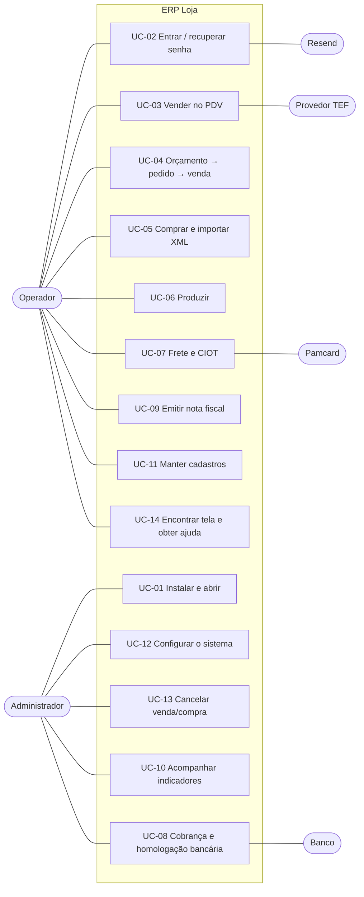

# 03 — Casos de uso

| | |
|---|---|
| **Documento** | Especificação de casos de uso |
| **Sistema** | ERP Loja 1.1.0 |
| **Atores** | Administrador, Operador (usuário comum), Banco, Administradora de CIOT (Pamcard), Provedor TEF, Resend, Fornecedor (XML) |

---

## UC-01 — Instalar e abrir o sistema
- **Ator**: Administrador. **Pré-condição**: Windows 10/11 x64.
- **Fluxo principal**
  1. O ator copia `ErpLoja.exe` para uma pasta e o executa.
  2. O sistema localiza o banco (RN-BD-01), aplica migrações pendentes com backup (RN-BD-02/03) e faz o backup diário (RN-BD-04).
  3. O sistema exibe a tela de acesso.
- **Fluxos alternativos**
  - 2a. Banco não encontrado: o sistema exibe as opções *Criar banco novo* (ao lado do executável ou em pasta escolhida) e *Indicar arquivo* (validado como banco do sistema). O caminho fica lembrado.
  - 2b. Banco de versão mais nova que o executável: o sistema recusa e orienta a atualizar o executável.
  - 2c. Falha numa migração: a migração é desfeita; o sistema informa o backup e volta à escolha do banco.
- **Pós-condição**: banco na versão do sistema e lembrado para a próxima abertura.

## UC-02 — Entrar e recuperar a senha
- **Fluxo principal**: informar username e senha (RN-USU-01) → janela principal. Sem e-mail cadastrado, o sistema avisa (RN-USU-03).
- **Alternativo — Esqueci minha senha**
  1. O ator informa username ou e-mail e pede o código.
  2. O sistema gera o código, grava o hash e envia pelo Resend (RN-USU-06), mostrando o e-mail mascarado.
  3. O ator informa código e nova senha; o sistema confere validade, tentativas e grava a senha.
  - 2a. Envio não configurado / domínio não verificado / sem internet: mensagem específica ([10](10-falhas-e-resolucoes.md)).
  - 3a. Código errado: decrementa tentativas; na 5ª o código é invalidado. Código expirado: solicitar outro.

## UC-03 — Vender no PDV
- **Ator**: Operador. **Pré-condição**: produtos cadastrados.
- **Fluxo principal**
  1. O ator lê o código de barras / digita o código (ou `N*código`) e tecla Enter; o sistema lança o item, atualiza o último item e o total (RN-VEN-01/04).
  2. Opcionalmente: F2 cliente, F4 quantidade, F5 desconto (RN-VEN-02), F6 remover item.
  3. F10: o ator escolhe a forma de pagamento (1–5) e confirma.
  4. Cartão/PIX com TEF ativo: o sistema aciona o provedor; aprovada, fica pendente (RN-TEF-02).
  5. O sistema grava a venda (estoque, contas), confirma o TEF e imprime conforme parâmetros (RN-VEN-11, RN-TEF-05).
- **Alternativos**
  - 1a. Estoque insuficiente: perguntar/permitir/bloquear (RN-VEN-03).
  - 3a. A prazo sem cliente: o sistema pede o cliente. Limite de crédito excedido: só administrador (RN-VEN-08).
  - 4a. Transação negada/cancelada: volta ao PDV sem gravar.
  - 5a. Falha ao gravar: a transação TEF é desfeita. Falha de impressão: venda mantida, aviso exibido.

## UC-04 — Orçamento → pedido → venda
1. O ator cria o orçamento (itens, descontos, frete, condição, validade) e imprime.
2. Aprovado pelo cliente, o ator aprova: o sistema gera o pedido de venda (RN-PED-03).
3. O ator fatura o pedido (ou "Salvar e faturar"): o sistema confere estoque, pergunta a condição de pagamento e gera a venda (RN-PED-04), oferecendo emitir a nota (UC-09).
- **Alternativos**: recusar/cancelar orçamento; orçamento vencido aprovado com confirmação; cancelar a venda reabre o pedido (RN-VEN-10).

## UC-05 — Comprar e importar XML
- **Pedido de compra**: criar → receber mercadoria (forma, parcelas, NF) → estoque, custo médio com rateio (RN-CUS-04) e contas a pagar. "Salvar e receber" faz a entrada imediata.
- **XML**: selecionar o arquivo → o sistema lê, recusa duplicidade, localiza fornecedor e sugere vínculos (RN-XML-01..03) → o ator confere produtos e fatores → importa: cadastra o que faltar, memoriza vínculos, gera compra e contas pelas duplicatas (RN-XML-04..06).

## UC-06 — Produzir
1. O ator monta a ficha técnica do produto (insumos, perdas, rendimento, custo adicional) e vê custo e margem estimados.
2. Cria a OP (necessidade calculada — RN-PRO-02), imprime e inicia.
3. Conclui informando a quantidade produzida: o sistema baixa insumos, dá entrada no produto e apura o custo real (RN-PRO-04).
- **Alternativo**: insumo insuficiente segue o parâmetro (RN-PRO-05); OP cancelada não movimenta estoque.

## UC-07 — Frete e CIOT
1. O ator registra o frete (modalidade, transportador, motorista, veículo, rota, carga, valores). O editor indica se o CIOT é obrigatório (RN-TRA-02).
2. Declara o CIOT: o sistema valida (RN-TRA-03) e envia à administradora (Pamcard/simulador), gravando código e protocolo.
3. Gera as contas a pagar (RN-TRA-07), marca em trânsito e entregue, e encerra o CIOT.
- **Alternativos**: administradora sem credenciais → orientação de configuração; cancelamento do CIOT com motivo antes de cancelar o frete (RN-TRA-06).

## UC-08 — Cobrança e homologação bancária
- **Cobrança**: emitir boletos das contas a receber → gerar remessa CNAB 240 → enviar ao banco → importar retorno (liquidação baixa as contas) (RN-COB).
- **Homologação** (conta em ambiente HOMOLOGACAO): gerar boletos de teste → imprimir e enviar remessa de teste ao banco → validar arquivos no validador CNAB 240 → importar o retorno do banco (ou simular) → com aprovação, mudar a conta para PRODUCAO.

## UC-09 — Emitir nota fiscal
1. O ator cria a nota a partir de uma venda/compra sem nota (ou avulsa); o sistema preenche participante, itens, CFOP e tributos (RN-FIS-02/03, RN-REF).
2. Ajusta o necessário e escolhe *Salvar e emitir*: o sistema valida (RN-FIS-05), numera, gera a chave (RN-FIS-06/07) e mostra o DANFE.
- **Alternativos**: rascunho salvo sem numerar; nota existente para a venda é aberta em vez de criar outra (RN-FIS-01); cancelamento de nota (RN-FIS-08).

## UC-10 — Acompanhar indicadores
O ator abre *Painel gerencial* (F5), escolhe o período e analisa indicadores (com variação sobre o período anterior) e gráficos; ou abre *Relatórios*, gera e exporta CSV.

## UC-11 — Manter cadastros
O ator mantém pessoas (papéis), produtos, categorias, veículos, contas bancárias e usuários (administrador), com filtros, validações (RN-CAD) e inativação no lugar de exclusão quando há histórico.

## UC-12 — Configurar o sistema
O administrador ajusta parâmetros por aba (RN-PAR), testa e-mail e impressora, faz backup, troca de banco ou gera dados de demonstração. Usuários comuns acessam apenas *Minha conta* (e-mail e senha).

## UC-13 — Cancelar venda ou compra
O administrador cancela a venda/compra em *Vendas realizadas* / *Compras realizadas*; o sistema estorna estoque, contas, TEF (vendas) e reabre o pedido de origem (RN-VEN-10, RN-COM-03).

## UC-14 — Encontrar tela e obter ajuda
- O ator tecla Ctrl+K (ou "Buscar tela"), digita uma palavra e abre a tela pelo resultado.
- Em qualquer tela, o ator clica no "?" (ou F1) e lê somente a explicação daquela tela.
