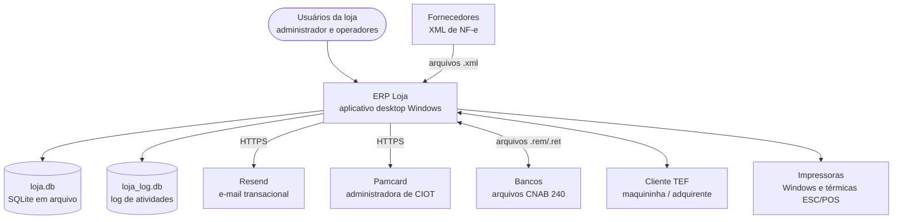
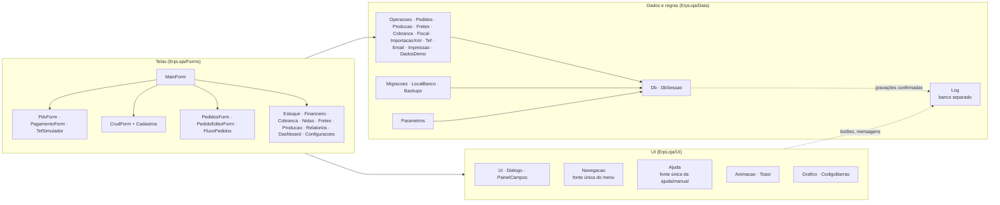
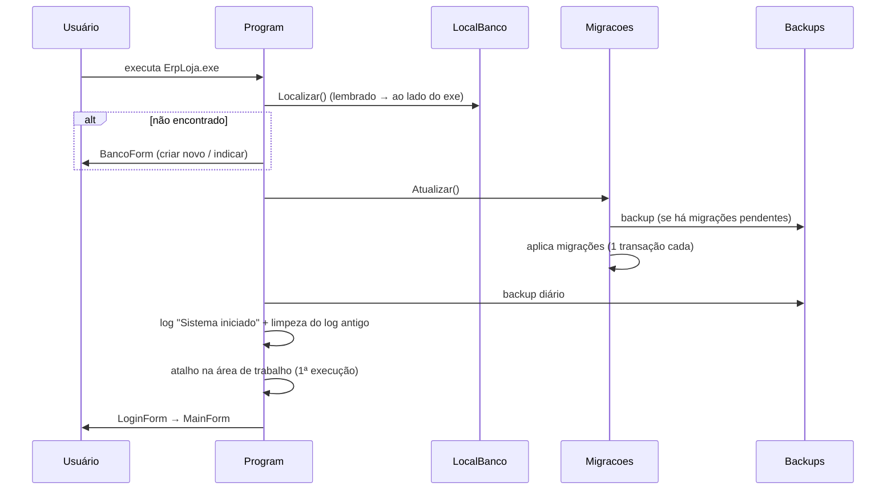

# 05 — Arquitetura de software

| | |
|---|---|
| **Documento** | Descrição de arquitetura (visões no modelo C4 + decisões registradas em ADRs) |
| **Sistema** | ERP Loja 1.2.0 (banco v12) |
| **Público** | Desenvolvedores e mantenedores |

## 1. Visão de contexto (C4 nível 1)



## 2. Visão de contêineres (C4 nível 2)

| Contêiner | Tecnologia | Responsabilidade |
|---|---|---|
| `ErpLoja.exe` | .NET 10, Windows Forms, executável único autocontido e ofuscado | Toda a aplicação: interface, regras, acesso a dados, integrações |
| `loja.db` | SQLite 3 (Microsoft.Data.Sqlite / SQLitePCLRaw) | Persistência; um arquivo por empresa |
| `loja_log.db` | SQLite 3, modo WAL | Log de atividades (quem fez o quê, onde e quando) — [ADR-0016](adr/0016-log-em-banco-separado.md) |
| Atalho `ERP Loja.lnk` | Área de trabalho | Criado na primeira execução |
| `backups/` | Arquivos `.db` | Cópias consistentes (API de backup do SQLite) |
| `%LOCALAPPDATA%\ErpLoja\banco.txt` | Texto | Caminho do último banco usado nesta máquina |

## 3. Visão de componentes (C4 nível 3)



### 3.1 Responsabilidades por camada

- **Data** concentra **todas as regras de negócio e o SQL de escrita**. Operações que alteram várias tabelas usam uma única transação (`DbSessao(transacao: true)`): tudo ou nada.
- **Forms** montam telas, validam entrada e chamam a camada Data; consultas de listagem (SELECT) ficam nas telas.
- **UI** reúne componentes reutilizados (estilo, grades, diálogos, gráficos, animações, ajuda, navegação).

### 3.2 Fontes únicas (evitam redundância e documentação desatualizada)

| Fonte única | Alimenta |
|---|---|
| `Navegacao.Telas()` | Menu lateral, atalhos, localizador de telas (Ctrl+K), cor do módulo de cada janela |
| `Ajuda.Topicos` | Botão "?"/F1 de cada tela e [manual do usuário](12-manual-do-usuario.md) |
| `Parametros.Definicoes` | Tela de configurações, valores padrão e migração de parâmetros |
| `Migracoes.Todas` | Esquema do banco e [modelo de dados](06-modelo-de-dados.md) gerado |
| `Log.Registrar` (chamado por `DbSessao`, `Ui` e `MainForm`) | Log de atividades de todas as telas sem código de log em cada uma |

### 3.3 Janela principal e telas embutidas

As telas do menu são `Form` comuns; a `MainForm` as converte em conteúdo do palco (`TopLevel = false`, sem borda,
`Dock = Fill`) e cria uma aba para cada uma ([ADR-0017](adr/0017-telas-embutidas-em-abas.md)). Diálogos de edição e
confirmação continuam modais. As teclas são tratadas primeiro pela tela ativa (`ProcessCmdKey` sobe do controle focado
até a janela principal), por isso o PDV mantém suas teclas de função.

## 4. Fluxo de inicialização



## 5. Dados e migrations

- Acesso por SQL parametrizado (`@p0..@pN`) via `Db`/`DbSessao` ([ADR-0005](adr/0005-sql-sem-orm.md)). Conexão abre em modo leitura/escrita **sem criar** o arquivo; só `LocalBanco.CriarNovo` cria.
- `DbSessao.Query` deduz o tipo das colunas (o SQLite é dinamicamente tipado) para formatação e ordenação corretas.
- O [modelo de dados](06-modelo-de-dados.md) é gerado do esquema real a cada execução dos testes.

### Migrations

| Versão | Conteúdo |
|---|---|
| 1 | Estrutura inicial e usuário admin |
| 2 | Pedidos/orçamentos, notas fiscais, vínculo produto × fornecedor, campos fiscais, frete em vendas |
| 3 | `usuarios.login` → `username`, e-mail único, recuperação de senha |
| 4 | Parâmetros padrão |
| 5 | **Cadastro único de pessoas**: une `clientes` e `fornecedores` em `pessoas` (mesmo CPF/CNPJ = mesma pessoa), remapeia e repõe todas as chaves estrangeiras |
| 6 | Produção: tipo do produto, fichas técnicas, ordens de produção |
| 7 | Transporte: motoristas, veículos, fretes e CIOT; contas ligadas a frete |
| 8 | TEF: transações |
| 9 | Cobrança bancária: contas bancárias, boletos, remessas, retornos |
| 10 | Reforma tributária: campos IBS/CBS/IS em produtos, itens e notas |
| 11 | Parâmetros dos novos módulos |
| 12 | Parâmetro de retenção do log de atividades |

**Regras para criar migração**
1. Acrescente `new(N, "descrição", MNNN)` no fim de `Migracoes.Todas`; nunca altere migração publicada.
2. Use `AdicionarColuna` (idempotente) e `Config` (parâmetro com valor padrão).
3. Para mudar chaves estrangeiras/estrutura de tabelas use `ReconstroiTabelas: true` e `RepontarReferencias` (procedimento seguro do SQLite: criar tabela nova, copiar, apagar, renomear, recriar índices com FKs desligadas; `foreign_key_check` antes de confirmar). **Nunca** apague tabela-pai com FKs ligadas: o `ON DELETE CASCADE` apagaria os filhos.
4. Novo parâmetro: inclua em `Parametros.Definicoes` **e** grave o padrão numa migração nova.
5. Rode a bateria: ela migra bancos legados reais (v1, v2, v4 com dados) até a versão atual.

## 6. Integrações

| Integração | Componente | Padrão adotado |
|---|---|---|
| E-mail (Resend) | `Email` | HTTP POST JSON com chave Bearer; transporte substituível em testes |
| CIOT | `IAdministradoraCiot` (`CiotSimulador`, `PamcardAdministradora`, `AdministradoraNaoIntegrada`) | Estratégia por parâmetro; mensagem da Pamcard isolada em `MontarDeclaracao`/`Interpretar` ([ADR-0012](adr/0012-ciot-administradora-abstrata.md)) |
| TEF | `IProvedorTef` (`TefSimulador`, `ProvedorTefNaoInstalado`) + `Tef` | Duas fases: pendente → confirmada/desfeita ([ADR-0009](adr/0009-tef-duas-fases.md)) |
| Cobrança | `Cobranca` | Febraban (código de barras, linha digitável, fator de vencimento) + campo livre por modelo; CNAB 240 P/Q/R e T/U ([ADR-0011](adr/0011-cobranca-generica-febraban.md)) |
| XML NF-e | `ImportacaoXml` | LINQ to XML no namespace da NF-e; vínculos memorizados |
| Impressoras | `Impressao` | Texto com marcações; Windows (driver) ou ESC/POS RAW pelo spooler ([ADR-0014](adr/0014-impressao-marcacoes-escpos.md)) |

## 7. Segurança

| Tema | Medida |
|---|---|
| Senhas | PBKDF2-SHA256, 100.000 iterações, salt 16 bytes, comparação em tempo constante |
| Recuperação | Código aleatório criptográfico, só o hash é guardado, 15 min, 5 tentativas, uso único |
| Autorização | Perfis administrador/comum; operações sensíveis verificadas na tela e na regra |
| Injeção de SQL | Somente parâmetros; nomes de tabela/coluna dinâmicos vêm de definições internas, nunca do usuário |
| Código distribuído | Ofuscação na publicação ([ADR-0010](adr/0010-ofuscacao.md)); limites descritos em [SECURITY.md](../SECURITY.md) |
| Segredos | Chave do Resend e senha da Pamcard ficam na tabela `configuracoes` (mascaradas na tela); proteger a pasta do banco |

## 8. Build, publicação e ofuscação

```
dotnet build ErpLoja.sln                                    # desenvolvimento (sem ofuscação)
dotnet run --project testes/ErpLoja.Testes                  # bateria (gera docs 06, 08 e 12)
dotnet tool restore                                         # instala o Obfuscar local (dotnet-tools.json)
dotnet publish ErpLoja/ErpLoja.csproj -c Release -o dist    # executável único + ofuscado
powershell -File testes/interface/teste-interface.ps1 -Pasta <pasta com exe e loja.db>   # teste de interface
```

O alvo `OfuscarAssembly` do `ErpLoja.csproj` roda após `ComputeResolvedFilesToPublishList`: copia a DLL do sistema,
gera `obfuscar.xml` com os diretórios de referência do runtime, executa o Obfuscar e substitui a DLL que vai para o
pacote único. Tipos usados por nome em tempo de execução (ligação de grades e P/Invoke) estão marcados com
`[Obfuscation(Exclude = true, ApplyToMembers = true)]`; chaves de ajuda usam `nameof` (resolvido na compilação).
`-p:Ofuscar=false` publica sem ofuscar, para diagnóstico.

## 9. Atributos de qualidade e táticas

| Atributo | Táticas |
|---|---|
| Confiabilidade | Transações; FKs ligadas; backups; validação de arquivos CNAB; TEF em duas fases |
| Auditabilidade | Log de atividades de cada ação (acesso, tela, botão, gravação, erro) em banco separado |
| Manutenibilidade | Camadas; fontes únicas; migrations; documentação gerada; bateria ponta a ponta |
| Usabilidade | Ajuda contextual; localizador; atalhos; PDV por teclado; cores por módulo; animações curtas; avisos não bloqueantes |
| Portabilidade | Executável único autocontido; preferências por máquina em `%LOCALAPPDATA%` (sobrescrevível por `ERPLOJA_PREFERENCIAS`) |
| Testabilidade | Transportes HTTP substituíveis; simuladores (TEF, CIOT, retorno bancário); dados de demonstração reproduzíveis |

## 10. Registro de decisões (ADR)

| ADR | Decisão |
|---|---|
| [0001](adr/0001-windows-forms-desktop.md) | Aplicativo desktop Windows Forms |
| [0002](adr/0002-sqlite-banco-local.md) | SQLite em arquivo local |
| [0003](adr/0003-executavel-unico.md) | Executável único autocontido |
| [0004](adr/0004-migrations-versionadas.md) | Migrations versionadas com `__migracoes` |
| [0005](adr/0005-sql-sem-orm.md) | SQL parametrizado sem ORM |
| [0006](adr/0006-ajuda-fonte-unica.md) | Ajuda como fonte única do manual |
| [0007](adr/0007-navegacao-fonte-unica.md) | Navegação como fonte única e não redundância |
| [0008](adr/0008-cadastro-unico-pessoas.md) | Cadastro único de pessoas |
| [0009](adr/0009-tef-duas-fases.md) | TEF em duas fases com provedor abstrato |
| [0010](adr/0010-ofuscacao.md) | Ofuscação do executável publicado |
| [0011](adr/0011-cobranca-generica-febraban.md) | Cobrança genérica Febraban/CNAB 240 |
| [0012](adr/0012-ciot-administradora-abstrata.md) | CIOT por administradora abstrata (Pamcard primeiro) |
| [0013](adr/0013-reforma-tributaria-parametrizada.md) | Reforma tributária parametrizada |
| [0014](adr/0014-impressao-marcacoes-escpos.md) | Impressão por marcações e ESC/POS |
| [0015](adr/0015-estrategia-de-testes.md) | Testes ponta a ponta + teste de interface |
| [0016](adr/0016-log-em-banco-separado.md) | Log de atividades em banco SQLite separado |
| [0017](adr/0017-telas-embutidas-em-abas.md) | Telas embutidas em abas na janela principal |
| [0018](adr/0018-cenarios-de-uso-automatizados.md) | Cenários de uso automatizados e testes exploratórios por agentes |
