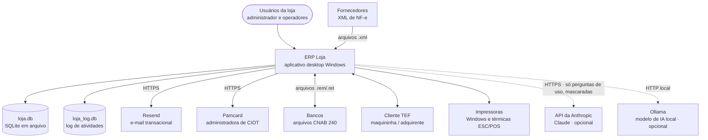
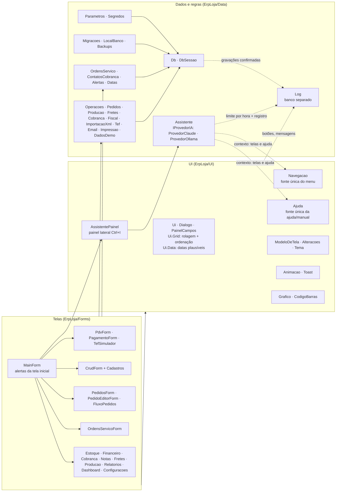
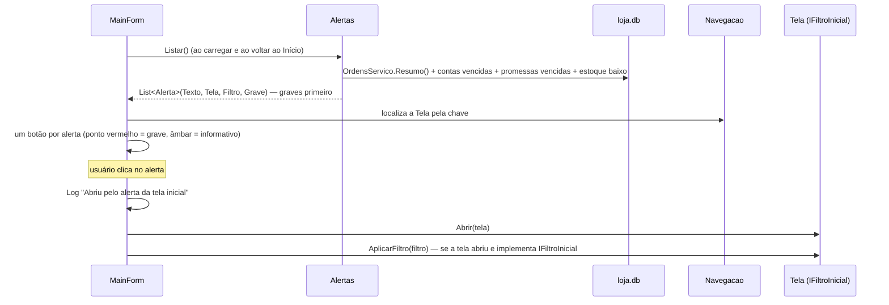
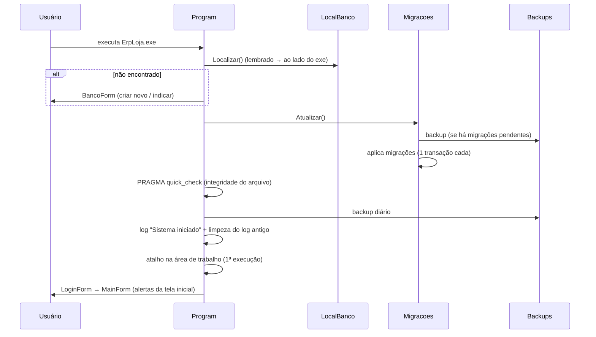
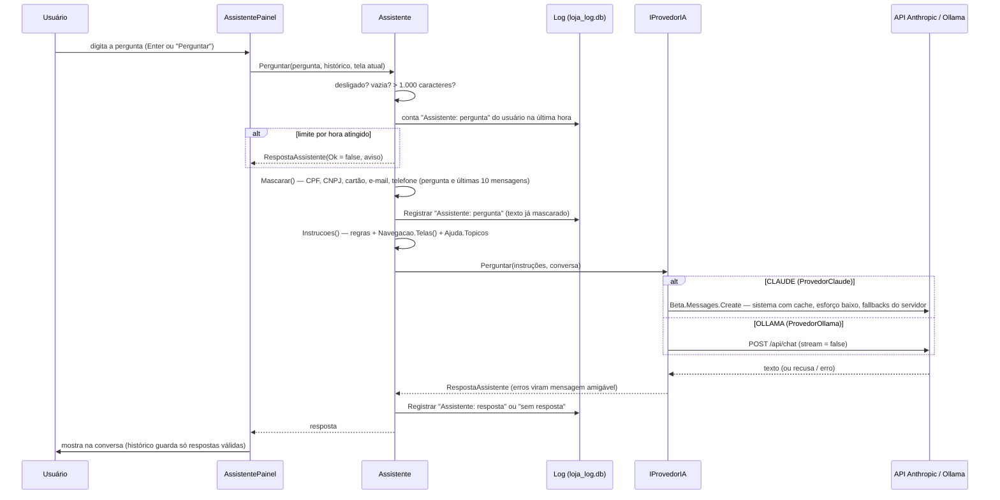

# 05 — Arquitetura de software

| | |
|---|---|
| **Documento** | Descrição de arquitetura (visões no modelo C4 + decisões registradas em ADRs) |
| **Sistema** | ERP Loja 1.5.0 (banco v16) |
| **Público** | Desenvolvedores e mantenedores |

## 1. Visão de contexto (C4 nível 1)



As duas dependências de IA são **opcionais** e mutuamente exclusivas: o assistente de dúvidas vem desligado
(`ia_ativa = N`) e, quando ligado, usa um único provedor (`ia_provedor` = `CLAUDE` ou `OLLAMA`) — [ADR-0021](adr/0021-assistente-ia-somente-documentacao.md).
Sem internet, só o assistente no modo `CLAUDE` deixa de responder; o resto do sistema não depende dele.

## 2. Visão de contêineres (C4 nível 2)

| Contêiner | Tecnologia | Responsabilidade |
|---|---|---|
| `ErpLoja.exe` | .NET 10, Windows Forms, executável único autocontido e ofuscado | Toda a aplicação: interface, regras, acesso a dados, integrações |
| `loja.db` | SQLite 3 (Microsoft.Data.Sqlite / SQLitePCLRaw) | Persistência; um arquivo por empresa |
| `loja_log.db` | SQLite 3, `journal_mode = DELETE` (sem `-wal`/`-shm`) | Log de atividades (quem fez o quê, onde e quando), com cadeia de hashes — [ADR-0016](adr/0016-log-em-banco-separado.md); também serve de contador do limite de perguntas ao assistente |
| Atalho `ERP Loja.lnk` | Área de trabalho | Criado na primeira execução |
| `backups/` | Arquivos `.db` | Cópias consistentes (API de backup do SQLite) |
| `%LOCALAPPDATA%\ErpLoja\banco.txt` | Texto | Caminho do último banco usado nesta máquina |
| API da Anthropic (externa, opcional) | HTTPS, SDK oficial `Anthropic` 12.53.0 | Responde às perguntas do assistente no modo `CLAUDE` |
| Ollama (local, opcional) | HTTP em `http://localhost:11434` (configurável) | Responde às perguntas do assistente no modo `OLLAMA`; nada sai da máquina |

## 3. Visão de componentes (C4 nível 3)



### 3.1 Responsabilidades por camada

- **Data** concentra **todas as regras de negócio e o SQL de escrita**. Operações que alteram várias tabelas usam uma única transação (`DbSessao(transacao: true)`): tudo ou nada. Exemplos da 1.5.0: `OrdensServico.Faturar` (parcelas + `faturada_em` + histórico), `Operacoes.BaixarLote` (todas as contas selecionadas ou nenhuma) e `ContatosCobranca.Registrar`.
- **Forms** montam telas, validam entrada e chamam a camada Data; consultas de listagem (SELECT) ficam nas telas.
- **UI** reúne componentes reutilizados (estilo, grades, diálogos, gráficos, animações, ajuda, navegação, painel do assistente).
- Algumas classes de Data usam utilitários de formatação de `UI.Ui` (`Ui.Txt`, `Ui.Dec`, `Ui.Moeda`) e o `Assistente` lê `Navegacao` e `Ajuda` para montar o contexto; essa dependência Data → UI é conhecida e terá de ser separada antes de um núcleo compartilhado (ver [ADR-0022](adr/0022-app-celular-api-local.md)).

### 3.2 Fontes únicas (evitam redundância e documentação desatualizada)

| Fonte única | Alimenta |
|---|---|
| `Navegacao.Telas()` | Menu lateral, atalhos, localizador de telas (Ctrl+K), cor do módulo de cada janela, destino dos alertas da tela inicial, lista de telas enviada ao assistente |
| `Ajuda.Topicos` | Botão "?"/F1 de cada tela, [manual do usuário](12-manual-do-usuario.md) e contexto do assistente de IA |
| `Parametros.Definicoes` | Tela de configurações, valores padrão e migração de parâmetros (inclusive o grupo "Assistente (IA)") |
| `Migracoes.Todas` | Esquema do banco e [modelo de dados](06-modelo-de-dados.md) gerado |
| `Log.Registrar` (chamado por `DbSessao`, `Ui`, `MainForm` e `Assistente`) | Log de atividades de todas as telas sem código de log em cada uma |
| `Ui.Grid()` | Aparência, estado vazio, destaque da linha, **rolagem horizontal** e **ordenação** de todas as tabelas ([ADR-0024](adr/0024-tabelas-rolagem-e-ordenacao-centralizadas.md)) |
| `Ui.Data()` + `Datas` | Faixa de datas aceitas em todos os campos de data (01/01/2000 a hoje + 10 anos) e nas regras que recebem datas |
| `Alertas.Listar()` | Avisos da tela inicial ([ADR-0025](adr/0025-alertas-na-tela-inicial.md)) |

### 3.3 Janela principal e telas embutidas

As telas do menu são `Form` comuns; a `MainForm` as converte em conteúdo do palco (`TopLevel = false`, sem borda,
`Dock = Fill`), uma por vez, no modelo padrão (filtros em cima, listagem ao meio, opções à direita) e com proteção de dados não salvos ([ADR-0019](adr/0019-uma-tela-por-vez-e-dados-nao-salvos.md)); o tema claro/escuro é aplicado por mapeamento de cores ([ADR-0020](adr/0020-tema-claro-e-escuro.md)). Diálogos de edição e
confirmação continuam modais. As teclas são tratadas primeiro pela tela ativa (`ProcessCmdKey` sobe do controle focado
até a janela principal), por isso o PDV mantém suas teclas de função.

O **painel do assistente** (`AssistentePainel`, `Dock = Right`) fica na área à direita do menu, ao lado do palco: abre e
fecha com Ctrl+I ou o botão "✦ Assistente" do cabeçalho (`MainForm.AlternarAssistente`) **sem substituir a tela
atual**. O título da tela ativa vai junto da pergunta (`TelaAtual`) para contextualizar. O painel é marcado como filtro
(`Alteracoes.MarcaFiltros`): conversar não conta como dado não salvo da tela.

### 3.4 Alertas da tela inicial



- `Alerta` aponta a tela pela **chave de `Navegacao`** e um código de filtro (`Alertas.OsAtrasadas`, `ContasVencidas`, `EstoqueBaixo`...).
- Implementam `IFiltroInicial`: `OrdensServicoForm` (atrasadas, hoje, prontas, a faturar), `FinanceiroForm` (vencidas, promessas vencidas) e `EstoqueForm` (estoque baixo).
- Falha de banco ao calcular alertas não impede abrir o sistema (lista vazia). Sem pendências, o bloco some.

### 3.5 Tabelas: rolagem e ordenação centralizadas

`Ui.Grid()` chama `RolarNaHorizontal` (largura mínima por coluna, calculada pelo título e pelo tipo de dado, com barra
horizontal quando não cabem) e `Ordenacao` (clique no título ordena; a coluna e a direção escolhidas são reaplicadas
quando a tela recarrega um `DataTable`). Listas de itens em `BindingList` (itens de pedido, nota e ficha técnica), que
não se ordenam sozinhas, são reordenadas por `Ui.OrdenarLista`. O PDV usa grade própria com `RolarNaHorizontal`, mas
marca as colunas como `NotSortable` (a ordem é a da venda). Detalhes em [ADR-0024](adr/0024-tabelas-rolagem-e-ordenacao-centralizadas.md).

## 4. Fluxos

### 4.1 Inicialização



### 4.2 Pergunta ao assistente de IA



- `Assistente.Perguntar` **nunca lança exceção**: falhas de rede, chave recusada, limite da conta e recusa do modelo voltam como texto para o usuário.
- O provedor é escolhido a cada pergunta por `Assistente.Provedor()` a partir dos parâmetros; nos testes, `ProvedorParaTestes` e `ProvedorClaude.TransporteParaTestes` substituem a rede.
- `ProvedorClaude`: modelo de `ia_modelo` (padrão `claude-opus-5-5`), `MaxTokens = 4000`, bloco de sistema com `CacheControl` efêmero (as instruções e o manual são iguais em toda pergunta), `Effort.Low` e o beta `server-side-fallback-2026-07-01` com `Fallbacks` padrão (o servidor escolhe o modelo reserva em caso de recusa ou indisponibilidade).
- `ProvedorOllama`: HTTP local (`ia_ollama_url` + `/api/chat`), tempo limite de 3 minutos.
- O limite por hora (`ia_limite_hora`, padrão 30) é contado no `loja_log.db`; se o log não puder ser lido, a contagem vale zero (o limite não bloqueia).

## 5. Dados e migrations

- Acesso por SQL parametrizado (`@p0..@pN`) via `Db`/`DbSessao` ([ADR-0005](adr/0005-sql-sem-orm.md)). Conexão abre em modo leitura/escrita **sem criar** o arquivo; só `LocalBanco.CriarNovo` cria.
- `DbSessao.Query` deduz o tipo das colunas (o SQLite é dinamicamente tipado) para formatação e ordenação corretas.
- O [modelo de dados](06-modelo-de-dados.md) é gerado do esquema real a cada execução dos testes.

### Migrations

| Versão | Conteúdo |
|---|---|
| 1 | Estrutura inicial e usuário admin |
| 2 | Pedidos/orçamentos, notas fiscais, vínculo produto × fornecedor, campos fiscais, frete em vendas |
| 3 | `usuarios.login` → `username`, e-mail único, recuperação de senha |
| 4 | Parâmetros padrão |
| 5 | **Cadastro único de pessoas**: une `clientes` e `fornecedores` em `pessoas` (mesmo CPF/CNPJ = mesma pessoa), remapeia e repõe todas as chaves estrangeiras |
| 6 | Produção: tipo do produto, fichas técnicas, ordens de produção |
| 7 | Transporte: motoristas, veículos, fretes e CIOT; contas ligadas a frete |
| 8 | TEF: transações |
| 9 | Cobrança bancária: contas bancárias, boletos, remessas, retornos |
| 10 | Reforma tributária: campos IBS/CBS/IS em produtos, itens e notas |
| 11 | Parâmetros dos novos módulos |
| 12 | Parâmetro de retenção do log de atividades |
| 13 | Segurança: `usuarios.falhas_login`/`bloqueado_ate`, gatilho que desbloqueia ao trocar a senha, credenciais de integração cifradas (DPAPI) |
| 14 | `usuarios.tema` (claro/escuro) |
| 15 | Parâmetros do assistente de IA (grupo "Assistente (IA)" de `Parametros.Definicoes`: `ia_ativa`, `ia_provedor`, `ia_chave_api`, `ia_modelo`, `ia_limite_hora`, `ia_ollama_url`, `ia_ollama_modelo`) |
| 16 | **Ordens de serviço**: `ordens_servico` (etapa com `CHECK`, prazo, valor, `entregue_em`, `faturada_em`), `os_historico`, `contas.os_id`; **contatos de cobrança**: `cobranca_contatos` (meio, resumo, promessa); parâmetro `os_prazo_dias` |

**Regras para criar migração**
1. Acrescente `new(N, "descrição", MNNN)` no fim de `Migracoes.Todas`; nunca altere migração publicada.
2. Use `AdicionarColuna` (idempotente) e `Config` (parâmetro com valor padrão).
3. Para mudar chaves estrangeiras/estrutura de tabelas use `ReconstroiTabelas: true` e `RepontarReferencias` (procedimento seguro do SQLite: criar tabela nova, copiar, apagar, renomear, recriar índices com FKs desligadas; `foreign_key_check` antes de confirmar). **Nunca** apague tabela-pai com FKs ligadas: o `ON DELETE CASCADE` apagaria os filhos.
4. Novo parâmetro: inclua em `Parametros.Definicoes` **e** grave o padrão numa migração nova.
5. Rode a bateria: ela migra bancos legados reais (v1, v2, v4 com dados) até a versão atual.

## 6. Integrações

| Integração | Componente | Padrão adotado |
|---|---|---|
| E-mail (Resend) | `Email` | HTTP POST JSON com chave Bearer; transporte substituível em testes |
| CIOT | `IAdministradoraCiot` (`CiotSimulador`, `PamcardAdministradora`, `AdministradoraNaoIntegrada`) | Estratégia por parâmetro; mensagem da Pamcard isolada em `MontarDeclaracao`/`Interpretar` ([ADR-0012](adr/0012-ciot-administradora-abstrata.md)) |
| TEF | `IProvedorTef` (`TefSimulador`, `ProvedorTefNaoInstalado`) + `Tef` | Duas fases: pendente → confirmada/desfeita ([ADR-0009](adr/0009-tef-duas-fases.md)) |
| Cobrança | `Cobranca` | Febraban (código de barras, linha digitável, fator de vencimento) + campo livre por modelo; CNAB 240 P/Q/R e T/U ([ADR-0011](adr/0011-cobranca-generica-febraban.md)) |
| XML NF-e | `ImportacaoXml` | LINQ to XML no namespace da NF-e; vínculos memorizados |
| Impressoras | `Impressao` | Texto com marcações; Windows (driver) ou ESC/POS RAW pelo spooler ([ADR-0014](adr/0014-impressao-marcacoes-escpos.md)); também imprime a ficha da OS (`OrdensServico.Texto`) |
| Assistente de IA (Claude) | `IProvedorIA` → `ProvedorClaude` | SDK oficial `Anthropic` (API Beta Messages); chave cifrada em `ia_chave_api`; transporte HTTP substituível em testes ([ADR-0021](adr/0021-assistente-ia-somente-documentacao.md)) |
| Assistente de IA (local) | `IProvedorIA` → `ProvedorOllama` | `HttpClient` + JSON (`System.Text.Json.Nodes`), sem pacote extra |

## 7. Segurança

| Tema | Medida |
|---|---|
| Senhas | PBKDF2-SHA256, 600.000 iterações, salt 16 bytes, comparação em tempo constante; hashes antigos refeitos no login |
| Acesso | Bloqueio de 15 minutos após 5 senhas erradas seguidas (migração 13) |
| Recuperação | Código aleatório criptográfico, só o hash é guardado, 15 min, 5 tentativas, uso único |
| Autorização | Perfis administrador/comum; operações sensíveis verificadas na tela e na regra |
| Injeção de SQL | Somente parâmetros; nomes de tabela/coluna dinâmicos vêm de definições internas, nunca do usuário |
| Integridade | `PRAGMA quick_check` a cada abertura do banco; log com cadeia de hashes |
| Código distribuído | Ofuscação na publicação ([ADR-0010](adr/0010-ofuscacao.md)); limites descritos em [SECURITY.md](../SECURITY.md) |
| Segredos | Chave do Resend, senha da Pamcard e chave da API da Anthropic cifradas com DPAPI (escopo da máquina) na tabela `configuracoes`, mascaradas na tela |
| Assistente de IA | Só recebe a documentação de uso, nunca dados da loja; não executa ações; máscara de dados pessoais; limite por hora; log de perguntas e respostas; regra contra instruções embutidas na pergunta ([ADR-0021](adr/0021-assistente-ia-somente-documentacao.md)) |

Avaliação completa em [15 — Segurança OWASP](15-seguranca-owasp.md).

## 8. Build, publicação e ofuscação

```
dotnet build ErpLoja.sln                                    # desenvolvimento (sem ofuscação)
dotnet run --project testes/ErpLoja.Testes                  # bateria (gera docs 06, 08 e 12)
dotnet tool restore                                         # instala o Obfuscar local (dotnet-tools.json)
dotnet publish ErpLoja/ErpLoja.csproj -c Release -o dist    # executável único + ofuscado
powershell -File testes/interface/teste-interface.ps1 -Pasta <pasta com exe e loja.db>   # teste de interface
```

O alvo `OfuscarAssembly` do `ErpLoja.csproj` roda após `ComputeResolvedFilesToPublishList`: copia a DLL do sistema,
gera `obfuscar.xml` com os diretórios de referência do runtime, executa o Obfuscar e substitui a DLL que vai para o
pacote único. Tipos usados por nome em tempo de execução (ligação de grades e P/Invoke) estão marcados com
`[Obfuscation(Exclude = true, ApplyToMembers = true)]`; chaves de ajuda usam `nameof` (resolvido na compilação).
`-p:Ofuscar=false` publica sem ofuscar, para diagnóstico.

**Dependências externas e ofuscação.** Só `ErpLoja.dll` é ofuscada (único `<Module>` do `obfuscar.xml`). As DLLs de
pacotes — `Microsoft.Data.Sqlite`/`SQLitePCLRaw` e, desde a 1.5.0, `Anthropic` 12.53.0 e sua dependência
`Microsoft.Extensions.AI.Abstractions` — entram no executável único **sem ofuscação** (são bibliotecas públicas; o
Obfuscar apenas as encontra pelos `AssemblySearchPath` para resolver referências). Consequências:
- o código do sistema que chama o SDK é renomeado normalmente; os tipos do SDK (`AnthropicClient`, `MessageCreateParams`...) não são, por isso a serialização JSON interna do SDK não depende de exclusões `[Obfuscation]` no nosso código;
- quem abrir o executável vê que ele usa o SDK da Anthropic (o nome e a versão da DLL ficam visíveis); a lógica do assistente fica ofuscada junto com o resto do sistema;
- textos fixos do `ProvedorClaude` (modelo padrão, nome do beta) ficam cifrados pela opção `HideStrings` como qualquer outra string do sistema;
- a chave da API **não** está no executável: é digitada em Configurações e gravada cifrada no banco;
- versões exatas (inclusive transitivas) ficam travadas em `packages.lock.json`.

## 9. Atributos de qualidade e táticas

| Atributo | Táticas |
|---|---|
| Confiabilidade | Transações (inclusive baixa em lote tudo ou nada); FKs ligadas; `CHECK` de etapa da OS; backups; validação de arquivos CNAB; TEF em duas fases; datas plausíveis |
| Auditabilidade | Log de atividades de cada ação (acesso, tela, botão, gravação, erro, ordenação, pergunta ao assistente) em banco separado; histórico de etapas da OS; contatos de cobrança com autor |
| Manutenibilidade | Camadas; fontes únicas; comportamento de tabelas centralizado em `Ui.Grid`; migrations; documentação gerada; bateria ponta a ponta |
| Usabilidade | Ajuda contextual; assistente de dúvidas; localizador; atalhos; alertas na tela inicial que abrem a tela filtrada; tabelas com rolagem e ordenação; PDV por teclado; cores por módulo; animações curtas; avisos não bloqueantes |
| Portabilidade | Executável único autocontido; preferências por máquina em `%LOCALAPPDATA%` (sobrescrevível por `ERPLOJA_PREFERENCIAS`) |
| Testabilidade | Transportes HTTP substituíveis (Resend, Anthropic); provedor de IA substituível; simuladores (TEF, CIOT, retorno bancário); dados de demonstração reproduzíveis |

## 10. Registro de decisões (ADR)

| ADR | Decisão |
|---|---|
| [0001](adr/0001-windows-forms-desktop.md) | Aplicativo desktop Windows Forms |
| [0002](adr/0002-sqlite-banco-local.md) | SQLite em arquivo local |
| [0003](adr/0003-executavel-unico.md) | Executável único autocontido |
| [0004](adr/0004-migrations-versionadas.md) | Migrations versionadas com `__migracoes` |
| [0005](adr/0005-sql-sem-orm.md) | SQL parametrizado sem ORM |
| [0006](adr/0006-ajuda-fonte-unica.md) | Ajuda como fonte única do manual |
| [0007](adr/0007-navegacao-fonte-unica.md) | Navegação como fonte única e não redundância |
| [0008](adr/0008-cadastro-unico-pessoas.md) | Cadastro único de pessoas |
| [0009](adr/0009-tef-duas-fases.md) | TEF em duas fases com provedor abstrato |
| [0010](adr/0010-ofuscacao.md) | Ofuscação do executável publicado |
| [0011](adr/0011-cobranca-generica-febraban.md) | Cobrança genérica Febraban/CNAB 240 |
| [0012](adr/0012-ciot-administradora-abstrata.md) | CIOT por administradora abstrata (Pamcard primeiro) |
| [0013](adr/0013-reforma-tributaria-parametrizada.md) | Reforma tributária parametrizada |
| [0014](adr/0014-impressao-marcacoes-escpos.md) | Impressão por marcações e ESC/POS |
| [0015](adr/0015-estrategia-de-testes.md) | Testes ponta a ponta + teste de interface |
| [0016](adr/0016-log-em-banco-separado.md) | Log de atividades em banco SQLite separado |
| [0017](adr/0017-telas-embutidas-em-abas.md) | Telas embutidas em abas (substituída pela 0019) |
| [0018](adr/0018-cenarios-de-uso-automatizados.md) | Cenários de uso automatizados e testes exploratórios por agentes |
| [0019](adr/0019-uma-tela-por-vez-e-dados-nao-salvos.md) | Uma tela por vez, modelo padrão e proteção de dados não salvos |
| [0020](adr/0020-tema-claro-e-escuro.md) | Tema claro e escuro por mapeamento de cores |
| [0021](adr/0021-assistente-ia-somente-documentacao.md) | Assistente de dúvidas por IA restrito à documentação |
| [0022](adr/0022-app-celular-api-local.md) | App de celular via API local no exe (proposta) |
| [0023](adr/0023-ordens-de-servico-genericas.md) | Ordens de serviço genéricas, faturamento separado da etapa e histórico |
| [0024](adr/0024-tabelas-rolagem-e-ordenacao-centralizadas.md) | Rolagem horizontal e ordenação de tabelas centralizadas em `Ui.Grid` |
| [0025](adr/0025-alertas-na-tela-inicial.md) | Alertas na tela inicial com abertura da tela já filtrada |
