# Modelo de dados

> Gerado automaticamente a partir do esquema real do banco (versão 12) pela bateria de testes. Não edite à mão.
> Para alterar o banco, crie uma migração (ver [arquitetura](05-arquitetura.md#migrations)).

Convenções: datas com hora em texto `yyyy-MM-dd HH:mm:ss`; datas sem hora `yyyy-MM-dd`; valores monetários em REAL com 2 casas;
booleanos em INTEGER (0/1); chaves estrangeiras verificadas (`PRAGMA foreign_keys = ON`).

## Diagrama entidade-relacionamento

```mermaid
erDiagram
    boletos {
        INTEGER id PK
        INTEGER conta_bancaria_id FK
        INTEGER conta_id FK
        INTEGER pagador_id FK
        TEXT nosso_numero
        TEXT numero_documento
        TEXT emissao
        TEXT vencimento
        REAL valor
        TEXT codigo_barras
        TEXT linha_digitavel
        TEXT status
        INTEGER remessa_id FK
        TEXT data_pagamento
        REAL valor_pago
        TEXT ocorrencia
        INTEGER baixa_solicitada
    }
    categorias {
        INTEGER id PK
        TEXT nome
    }
    compra_itens {
        INTEGER id PK
        INTEGER compra_id FK
        INTEGER produto_id FK
        REAL quantidade
        REAL custo_unitario
        REAL total
    }
    compras {
        INTEGER id PK
        TEXT data
        INTEGER fornecedor_id FK
        INTEGER usuario_id FK
        TEXT numero_nota
        REAL total
        TEXT forma_pagamento
        TEXT status
        TEXT observacoes
    }
    contas {
        INTEGER id PK
        TEXT tipo
        TEXT descricao
        REAL valor
        TEXT vencimento
        TEXT data_pagamento
        REAL valor_pago
        TEXT forma_pagamento
        TEXT status
        INTEGER cliente_id FK
        INTEGER fornecedor_id FK
        INTEGER venda_id FK
        INTEGER compra_id FK
        TEXT criado_em
        INTEGER frete_id FK
    }
    contas_bancarias {
        INTEGER id PK
        TEXT nome
        TEXT banco_codigo
        TEXT banco_nome
        TEXT agencia
        TEXT agencia_dv
        TEXT conta
        TEXT conta_dv
        TEXT carteira
        TEXT convenio
        TEXT campo_livre_modelo
        INTEGER nosso_numero_digitos
        INTEGER nosso_numero_atual
        INTEGER remessa_sequencia
        TEXT especie_titulo
        REAL multa_pct
        REAL juros_mes_pct
        INTEGER dias_protesto
        TEXT instrucoes
        TEXT ambiente
        INTEGER ativo
    }
    ficha_itens {
        INTEGER id PK
        INTEGER ficha_id FK
        INTEGER insumo_id FK
        REAL quantidade
        REAL perda_pct
    }
    fichas_tecnicas {
        INTEGER id PK
        INTEGER produto_id FK
        REAL rendimento
        REAL custo_adicional
        TEXT observacoes
        TEXT atualizado_em
    }
    fretes {
        INTEGER id PK
        TEXT data
        TEXT modalidade
        TEXT status
        INTEGER transportador_id FK
        INTEGER motorista_id FK
        INTEGER veiculo_id FK
        TEXT origem_cidade
        TEXT origem_uf
        TEXT destino_cidade
        TEXT destino_uf
        REAL distancia_km
        REAL peso_kg
        TEXT mercadoria
        REAL valor_frete
        REAL valor_pedagio
        REAL valor_adiantamento
        REAL outras_despesas
        TEXT previsao_entrega
        TEXT data_entrega
        INTEGER venda_id FK
        INTEGER nota_id FK
        INTEGER contas_geradas
        TEXT ciot
        TEXT ciot_protocolo
        TEXT ciot_status
        TEXT ciot_administradora
        TEXT ciot_mensagem
        TEXT observacoes
        INTEGER usuario_id FK
        TEXT criado_em
    }
    movimentacoes_estoque {
        INTEGER id PK
        TEXT data
        INTEGER produto_id FK
        TEXT tipo
        REAL quantidade
        REAL saldo
        TEXT origem
        INTEGER referencia_id
        INTEGER usuario_id FK
    }
    nota_itens {
        INTEGER id PK
        INTEGER nota_id FK
        INTEGER produto_id FK
        TEXT codigo
        TEXT descricao
        TEXT ncm
        TEXT cfop
        TEXT cst
        TEXT unidade
        REAL quantidade
        REAL valor_unitario
        REAL desconto
        REAL valor_total
        REAL aliq_icms
        REAL valor_icms
        REAL aliq_ipi
        REAL valor_ipi
        REAL aliq_pis
        REAL valor_pis
        REAL aliq_cofins
        REAL valor_cofins
        TEXT cst_ibscbs
        TEXT cclass_trib
        REAL base_ibscbs
        REAL aliq_ibs_uf
        REAL aliq_ibs_mun
        REAL aliq_cbs
        REAL valor_ibs_uf
        REAL valor_ibs_mun
        REAL valor_cbs
        REAL aliq_is
        REAL valor_is
    }
    notas_fiscais {
        INTEGER id PK
        TEXT tipo
        TEXT modelo
        INTEGER serie
        INTEGER numero
        TEXT chave
        TEXT data_emissao
        TEXT natureza_operacao
        INTEGER propria
        INTEGER cliente_id FK
        INTEGER fornecedor_id FK
        INTEGER venda_id FK
        INTEGER compra_id FK
        TEXT part_nome
        TEXT part_documento
        TEXT part_ie
        TEXT part_endereco
        TEXT part_cidade
        TEXT part_uf
        REAL valor_produtos
        REAL desconto
        REAL frete
        REAL valor_icms
        REAL valor_ipi
        REAL valor_pis
        REAL valor_cofins
        REAL valor_total
        TEXT info_complementar
        TEXT status
        TEXT xml
        INTEGER usuario_id FK
        TEXT criado_em
        REAL valor_ibs
        REAL valor_cbs
        REAL valor_is
    }
    op_itens {
        INTEGER id PK
        INTEGER op_id FK
        INTEGER insumo_id FK
        REAL quantidade_prevista
        REAL quantidade_consumida
        REAL custo_unitario
    }
    ordens_producao {
        INTEGER id PK
        TEXT data
        INTEGER produto_id FK
        REAL quantidade
        REAL quantidade_produzida
        TEXT status
        TEXT previsao
        TEXT inicio
        TEXT conclusao
        REAL custo_total
        REAL custo_unitario
        INTEGER pedido_id FK
        TEXT observacoes
        INTEGER usuario_id FK
    }
    pedido_itens {
        INTEGER id PK
        INTEGER pedido_id FK
        INTEGER produto_id FK
        REAL quantidade
        REAL preco_unitario
        REAL desconto
        REAL total
    }
    pedidos {
        INTEGER id PK
        TEXT tipo
        TEXT data
        INTEGER cliente_id FK
        INTEGER fornecedor_id FK
        INTEGER usuario_id FK
        TEXT validade
        REAL subtotal
        REAL desconto
        REAL frete
        REAL total
        TEXT forma_pagamento
        INTEGER parcelas
        TEXT observacoes
        TEXT status
        INTEGER origem_id FK
        INTEGER venda_id FK
        INTEGER compra_id FK
    }
    pessoas {
        INTEGER id PK
        TEXT nome
        TEXT fantasia
        TEXT cpf_cnpj
        TEXT ie
        TEXT telefone
        TEXT email
        TEXT contato
        TEXT endereco
        TEXT cidade
        TEXT uf
        TEXT cep
        INTEGER eh_cliente
        INTEGER eh_fornecedor
        INTEGER eh_transportador
        TEXT rntrc
        REAL limite_credito
        TEXT observacoes
        INTEGER ativo
        TEXT criado_em
        INTEGER eh_motorista
        TEXT cnh
        TEXT cnh_categoria
        TEXT cnh_validade
    }
    produtos {
        INTEGER id PK
        TEXT codigo
        TEXT codigo_barras
        TEXT nome
        INTEGER categoria_id FK
        TEXT unidade
        REAL preco_custo
        REAL preco_venda
        REAL estoque
        REAL estoque_minimo
        INTEGER ativo
        TEXT criado_em
        TEXT ncm
        TEXT cest
        INTEGER origem
        TEXT cst
        REAL aliq_icms
        REAL aliq_ipi
        REAL aliq_pis
        REAL aliq_cofins
        TEXT tipo
        TEXT cclass_trib
        TEXT cst_ibscbs
        REAL red_ibs_pct
        REAL red_cbs_pct
        REAL aliq_is
    }
    produtos_fornecedor {
        INTEGER fornecedor_id PK
        TEXT codigo_fornecedor PK
        INTEGER produto_id FK
        REAL fator
    }
    recuperacao_senha {
        INTEGER id PK
        INTEGER usuario_id FK
        TEXT codigo_hash
        TEXT expira_em
        INTEGER tentativas
        INTEGER usado
        TEXT criado_em
    }
    remessas {
        INTEGER id PK
        INTEGER conta_bancaria_id FK
        INTEGER sequencia
        TEXT data
        TEXT arquivo
        TEXT conteudo
        INTEGER quantidade
        REAL valor_total
        INTEGER homologacao
    }
    retornos {
        INTEGER id PK
        INTEGER conta_bancaria_id FK
        TEXT data
        TEXT arquivo
        TEXT conteudo
        INTEGER registros
        INTEGER liquidados
        REAL valor_liquidado
    }
    transacoes_tef {
        INTEGER id PK
        TEXT data
        INTEGER venda_id FK
        TEXT provedor
        TEXT modalidade
        TEXT bandeira
        INTEGER parcelas
        REAL valor
        TEXT nsu
        TEXT autorizacao
        TEXT status
        TEXT mensagem
        TEXT comprovante_cliente
        TEXT comprovante_loja
    }
    usuarios {
        INTEGER id PK
        TEXT nome
        TEXT username
        TEXT senha
        INTEGER admin
        INTEGER ativo
        TEXT email
    }
    veiculos {
        INTEGER id PK
        TEXT placa
        TEXT renavam
        TEXT tipo
        TEXT carroceria
        TEXT marca_modelo
        INTEGER ano
        TEXT uf
        REAL capacidade_kg
        REAL capacidade_m3
        REAL tara_kg
        TEXT rntrc
        INTEGER proprietario_id FK
        INTEGER frota_propria
        INTEGER ativo
    }
    venda_itens {
        INTEGER id PK
        INTEGER venda_id FK
        INTEGER produto_id FK
        REAL quantidade
        REAL preco_unitario
        REAL custo_unitario
        REAL total
    }
    vendas {
        INTEGER id PK
        TEXT data
        INTEGER cliente_id FK
        INTEGER usuario_id FK
        REAL subtotal
        REAL desconto
        REAL total
        TEXT forma_pagamento
        TEXT status
        TEXT observacoes
        REAL frete
    }
    remessas ||--o{ boletos : "remessa_id"
    pessoas ||--o{ boletos : "pagador_id"
    contas ||--o{ boletos : "conta_id"
    contas_bancarias ||--o{ boletos : "conta_bancaria_id"
    produtos ||--o{ compra_itens : "produto_id"
    compras ||--o{ compra_itens : "compra_id"
    usuarios ||--o{ compras : "usuario_id"
    pessoas ||--o{ compras : "fornecedor_id"
    fretes ||--o{ contas : "frete_id"
    compras ||--o{ contas : "compra_id"
    vendas ||--o{ contas : "venda_id"
    pessoas ||--o{ contas : "fornecedor_id"
    pessoas ||--o{ contas : "cliente_id"
    produtos ||--o{ ficha_itens : "insumo_id"
    fichas_tecnicas ||--o{ ficha_itens : "ficha_id"
    produtos ||--o{ fichas_tecnicas : "produto_id"
    usuarios ||--o{ fretes : "usuario_id"
    notas_fiscais ||--o{ fretes : "nota_id"
    vendas ||--o{ fretes : "venda_id"
    veiculos ||--o{ fretes : "veiculo_id"
    pessoas ||--o{ fretes : "motorista_id"
    pessoas ||--o{ fretes : "transportador_id"
    usuarios ||--o{ movimentacoes_estoque : "usuario_id"
    produtos ||--o{ movimentacoes_estoque : "produto_id"
    produtos ||--o{ nota_itens : "produto_id"
    notas_fiscais ||--o{ nota_itens : "nota_id"
    usuarios ||--o{ notas_fiscais : "usuario_id"
    compras ||--o{ notas_fiscais : "compra_id"
    vendas ||--o{ notas_fiscais : "venda_id"
    pessoas ||--o{ notas_fiscais : "fornecedor_id"
    pessoas ||--o{ notas_fiscais : "cliente_id"
    produtos ||--o{ op_itens : "insumo_id"
    ordens_producao ||--o{ op_itens : "op_id"
    usuarios ||--o{ ordens_producao : "usuario_id"
    pedidos ||--o{ ordens_producao : "pedido_id"
    produtos ||--o{ ordens_producao : "produto_id"
    produtos ||--o{ pedido_itens : "produto_id"
    pedidos ||--o{ pedido_itens : "pedido_id"
    compras ||--o{ pedidos : "compra_id"
    vendas ||--o{ pedidos : "venda_id"
    usuarios ||--o{ pedidos : "usuario_id"
    pessoas ||--o{ pedidos : "fornecedor_id"
    pessoas ||--o{ pedidos : "cliente_id"
    categorias ||--o{ produtos : "categoria_id"
    produtos ||--o{ produtos_fornecedor : "produto_id"
    pessoas ||--o{ produtos_fornecedor : "fornecedor_id"
    usuarios ||--o{ recuperacao_senha : "usuario_id"
    contas_bancarias ||--o{ remessas : "conta_bancaria_id"
    contas_bancarias ||--o{ retornos : "conta_bancaria_id"
    vendas ||--o{ transacoes_tef : "venda_id"
    pessoas ||--o{ veiculos : "proprietario_id"
    produtos ||--o{ venda_itens : "produto_id"
    vendas ||--o{ venda_itens : "venda_id"
    usuarios ||--o{ vendas : "usuario_id"
    pessoas ||--o{ vendas : "cliente_id"
```

## Dicionário de dados

### __migracoes

Controle de versão do banco: migrações aplicadas.

| Coluna | Tipo | Obrigatória | Padrão | Chave |
|---|---|:---:|---|---|
| `versao` | INTEGER | sim |  | PK |
| `nome` | TEXT | sim |  |  |
| `aplicada_em` | TEXT | sim |  |  |

Registros no banco de demonstração: 12.

### boletos

Boletos emitidos (nosso número, código de barras, linha digitável) e sua situação na cobrança.

| Coluna | Tipo | Obrigatória | Padrão | Chave |
|---|---|:---:|---|---|
| `id` | INTEGER | sim |  | PK |
| `conta_bancaria_id` | INTEGER | sim |  | FK → contas_bancarias.id |
| `conta_id` | INTEGER |  |  | FK → contas.id |
| `pagador_id` | INTEGER |  |  | FK → pessoas.id |
| `nosso_numero` | TEXT | sim |  |  |
| `numero_documento` | TEXT | sim |  |  |
| `emissao` | TEXT | sim |  |  |
| `vencimento` | TEXT | sim |  |  |
| `valor` | REAL | sim |  |  |
| `codigo_barras` | TEXT | sim |  |  |
| `linha_digitavel` | TEXT | sim |  |  |
| `status` | TEXT | sim | 'EMITIDO' |  |
| `remessa_id` | INTEGER |  |  | FK → remessas.id |
| `data_pagamento` | TEXT |  |  |  |
| `valor_pago` | REAL |  |  |  |
| `ocorrencia` | TEXT |  |  |  |
| `baixa_solicitada` | INTEGER | sim | 0 |  |

Índices: `ix_boletos_conta`

Registros no banco de demonstração: 8.

### categorias

Agrupamento de produtos para relatórios e painel.

| Coluna | Tipo | Obrigatória | Padrão | Chave |
|---|---|:---:|---|---|
| `id` | INTEGER | sim |  | PK |
| `nome` | TEXT | sim |  |  |

Registros no banco de demonstração: 9.

### compra_itens

Itens de cada compra, com o custo unitário de entrada.

| Coluna | Tipo | Obrigatória | Padrão | Chave |
|---|---|:---:|---|---|
| `id` | INTEGER | sim |  | PK |
| `compra_id` | INTEGER | sim |  | FK → compras.id (cascata) |
| `produto_id` | INTEGER | sim |  | FK → produtos.id |
| `quantidade` | REAL | sim |  |  |
| `custo_unitario` | REAL | sim |  |  |
| `total` | REAL | sim |  |  |

Índices: `ix_compra_itens_compra`

Registros no banco de demonstração: 282.

### compras

Entradas de mercadoria (pedido de compra recebido ou XML importado).

| Coluna | Tipo | Obrigatória | Padrão | Chave |
|---|---|:---:|---|---|
| `id` | INTEGER | sim |  | PK |
| `data` | TEXT | sim |  |  |
| `fornecedor_id` | INTEGER | sim |  | FK → pessoas.id |
| `usuario_id` | INTEGER |  |  | FK → usuarios.id |
| `numero_nota` | TEXT |  |  |  |
| `total` | REAL | sim | 0 |  |
| `forma_pagamento` | TEXT | sim |  |  |
| `status` | TEXT | sim | 'FINALIZADA' |  |
| `observacoes` | TEXT |  |  |  |

Registros no banco de demonstração: 48.

### configuracoes

Parâmetros do sistema (chave/valor), editados na tela Configurações.

| Coluna | Tipo | Obrigatória | Padrão | Chave |
|---|---|:---:|---|---|
| `chave` | TEXT | sim |  | PK |
| `valor` | TEXT |  |  |  |

Registros no banco de demonstração: 52.

### contas

Contas a receber e a pagar (parcelas), geradas por vendas, compras, fretes ou lançamento manual.

| Coluna | Tipo | Obrigatória | Padrão | Chave |
|---|---|:---:|---|---|
| `id` | INTEGER | sim |  | PK |
| `tipo` | TEXT | sim |  |  |
| `descricao` | TEXT | sim |  |  |
| `valor` | REAL | sim |  |  |
| `vencimento` | TEXT | sim |  |  |
| `data_pagamento` | TEXT |  |  |  |
| `valor_pago` | REAL |  |  |  |
| `forma_pagamento` | TEXT |  |  |  |
| `status` | TEXT | sim | 'ABERTA' |  |
| `cliente_id` | INTEGER |  |  | FK → pessoas.id |
| `fornecedor_id` | INTEGER |  |  | FK → pessoas.id |
| `venda_id` | INTEGER |  |  | FK → vendas.id |
| `compra_id` | INTEGER |  |  | FK → compras.id |
| `criado_em` | TEXT | sim | datetime('now', 'localtime') |  |
| `frete_id` | INTEGER |  |  | FK → fretes.id |

Índices: `ix_contas_status`

Registros no banco de demonstração: 1.686.

### contas_bancarias

Contas de cobrança: dados do banco, modelo do campo livre, sequências de nosso número e de remessa.

| Coluna | Tipo | Obrigatória | Padrão | Chave |
|---|---|:---:|---|---|
| `id` | INTEGER | sim |  | PK |
| `nome` | TEXT | sim |  |  |
| `banco_codigo` | TEXT | sim |  |  |
| `banco_nome` | TEXT |  |  |  |
| `agencia` | TEXT | sim |  |  |
| `agencia_dv` | TEXT |  |  |  |
| `conta` | TEXT | sim |  |  |
| `conta_dv` | TEXT |  |  |  |
| `carteira` | TEXT |  |  |  |
| `convenio` | TEXT |  |  |  |
| `campo_livre_modelo` | TEXT | sim |  |  |
| `nosso_numero_digitos` | INTEGER | sim | 11 |  |
| `nosso_numero_atual` | INTEGER | sim | 0 |  |
| `remessa_sequencia` | INTEGER | sim | 0 |  |
| `especie_titulo` | TEXT | sim | '02' |  |
| `multa_pct` | REAL | sim | 0 |  |
| `juros_mes_pct` | REAL | sim | 0 |  |
| `dias_protesto` | INTEGER | sim | 0 |  |
| `instrucoes` | TEXT |  |  |  |
| `ambiente` | TEXT | sim | 'HOMOLOGACAO' |  |
| `ativo` | INTEGER | sim | 1 |  |

Registros no banco de demonstração: 1.

### ficha_itens

Insumos de cada ficha técnica, com quantidade e perda.

| Coluna | Tipo | Obrigatória | Padrão | Chave |
|---|---|:---:|---|---|
| `id` | INTEGER | sim |  | PK |
| `ficha_id` | INTEGER | sim |  | FK → fichas_tecnicas.id (cascata) |
| `insumo_id` | INTEGER | sim |  | FK → produtos.id |
| `quantidade` | REAL | sim |  |  |
| `perda_pct` | REAL | sim | 0 |  |

Registros no banco de demonstração: 17.

### fichas_tecnicas

Receita de cada produto fabricado: rendimento e custo adicional por lote.

| Coluna | Tipo | Obrigatória | Padrão | Chave |
|---|---|:---:|---|---|
| `id` | INTEGER | sim |  | PK |
| `produto_id` | INTEGER | sim |  | FK → produtos.id |
| `rendimento` | REAL | sim | 1 |  |
| `custo_adicional` | REAL | sim | 0 |  |
| `observacoes` | TEXT |  |  |  |
| `atualizado_em` | TEXT |  |  |  |

Registros no banco de demonstração: 3.

### fretes

Fretes (frota própria ou contratados), valores, situação da viagem e dados do CIOT.

| Coluna | Tipo | Obrigatória | Padrão | Chave |
|---|---|:---:|---|---|
| `id` | INTEGER | sim |  | PK |
| `data` | TEXT | sim |  |  |
| `modalidade` | TEXT | sim | 'CONTRATADO' |  |
| `status` | TEXT | sim | 'ABERTO' |  |
| `transportador_id` | INTEGER |  |  | FK → pessoas.id |
| `motorista_id` | INTEGER |  |  | FK → pessoas.id |
| `veiculo_id` | INTEGER |  |  | FK → veiculos.id |
| `origem_cidade` | TEXT |  |  |  |
| `origem_uf` | TEXT |  |  |  |
| `destino_cidade` | TEXT |  |  |  |
| `destino_uf` | TEXT |  |  |  |
| `distancia_km` | REAL | sim | 0 |  |
| `peso_kg` | REAL | sim | 0 |  |
| `mercadoria` | TEXT |  |  |  |
| `valor_frete` | REAL | sim | 0 |  |
| `valor_pedagio` | REAL | sim | 0 |  |
| `valor_adiantamento` | REAL | sim | 0 |  |
| `outras_despesas` | REAL | sim | 0 |  |
| `previsao_entrega` | TEXT |  |  |  |
| `data_entrega` | TEXT |  |  |  |
| `venda_id` | INTEGER |  |  | FK → vendas.id |
| `nota_id` | INTEGER |  |  | FK → notas_fiscais.id |
| `contas_geradas` | INTEGER | sim | 0 |  |
| `ciot` | TEXT |  |  |  |
| `ciot_protocolo` | TEXT |  |  |  |
| `ciot_status` | TEXT | sim | 'NAO_SE_APLICA' |  |
| `ciot_administradora` | TEXT |  |  |  |
| `ciot_mensagem` | TEXT |  |  |  |
| `observacoes` | TEXT |  |  |  |
| `usuario_id` | INTEGER |  |  | FK → usuarios.id |
| `criado_em` | TEXT | sim | datetime('now', 'localtime') |  |

Índices: `ix_fretes_status`

Registros no banco de demonstração: 3.

### movimentacoes_estoque

Histórico de toda alteração de saldo de estoque, com o saldo resultante.

| Coluna | Tipo | Obrigatória | Padrão | Chave |
|---|---|:---:|---|---|
| `id` | INTEGER | sim |  | PK |
| `data` | TEXT | sim |  |  |
| `produto_id` | INTEGER | sim |  | FK → produtos.id |
| `tipo` | TEXT | sim |  |  |
| `quantidade` | REAL | sim |  |  |
| `saldo` | REAL | sim |  |  |
| `origem` | TEXT |  |  |  |
| `referencia_id` | INTEGER |  |  |  |
| `usuario_id` | INTEGER |  |  | FK → usuarios.id |

Índices: `ix_mov_produto`

Registros no banco de demonstração: 5.626.

### nota_itens

Itens das notas fiscais com tributos (ICMS, IPI, PIS, COFINS, IBS, CBS, IS).

| Coluna | Tipo | Obrigatória | Padrão | Chave |
|---|---|:---:|---|---|
| `id` | INTEGER | sim |  | PK |
| `nota_id` | INTEGER | sim |  | FK → notas_fiscais.id (cascata) |
| `produto_id` | INTEGER |  |  | FK → produtos.id |
| `codigo` | TEXT |  |  |  |
| `descricao` | TEXT | sim |  |  |
| `ncm` | TEXT |  |  |  |
| `cfop` | TEXT |  |  |  |
| `cst` | TEXT |  |  |  |
| `unidade` | TEXT |  |  |  |
| `quantidade` | REAL | sim |  |  |
| `valor_unitario` | REAL | sim |  |  |
| `desconto` | REAL | sim | 0 |  |
| `valor_total` | REAL | sim |  |  |
| `aliq_icms` | REAL | sim | 0 |  |
| `valor_icms` | REAL | sim | 0 |  |
| `aliq_ipi` | REAL | sim | 0 |  |
| `valor_ipi` | REAL | sim | 0 |  |
| `aliq_pis` | REAL | sim | 0 |  |
| `valor_pis` | REAL | sim | 0 |  |
| `aliq_cofins` | REAL | sim | 0 |  |
| `valor_cofins` | REAL | sim | 0 |  |
| `cst_ibscbs` | TEXT |  |  |  |
| `cclass_trib` | TEXT |  |  |  |
| `base_ibscbs` | REAL | sim | 0 |  |
| `aliq_ibs_uf` | REAL | sim | 0 |  |
| `aliq_ibs_mun` | REAL | sim | 0 |  |
| `aliq_cbs` | REAL | sim | 0 |  |
| `valor_ibs_uf` | REAL | sim | 0 |  |
| `valor_ibs_mun` | REAL | sim | 0 |  |
| `valor_cbs` | REAL | sim | 0 |  |
| `aliq_is` | REAL | sim | 0 |  |
| `valor_is` | REAL | sim | 0 |  |

Índices: `ix_nota_itens`

Registros no banco de demonstração: 17.

### notas_fiscais

Notas fiscais próprias (saída/entrada) e importadas de fornecedores (XML).

| Coluna | Tipo | Obrigatória | Padrão | Chave |
|---|---|:---:|---|---|
| `id` | INTEGER | sim |  | PK |
| `tipo` | TEXT | sim |  |  |
| `modelo` | TEXT | sim | '55' |  |
| `serie` | INTEGER | sim | 1 |  |
| `numero` | INTEGER |  |  |  |
| `chave` | TEXT |  |  |  |
| `data_emissao` | TEXT | sim |  |  |
| `natureza_operacao` | TEXT | sim |  |  |
| `propria` | INTEGER | sim | 1 |  |
| `cliente_id` | INTEGER |  |  | FK → pessoas.id |
| `fornecedor_id` | INTEGER |  |  | FK → pessoas.id |
| `venda_id` | INTEGER |  |  | FK → vendas.id |
| `compra_id` | INTEGER |  |  | FK → compras.id |
| `part_nome` | TEXT |  |  |  |
| `part_documento` | TEXT |  |  |  |
| `part_ie` | TEXT |  |  |  |
| `part_endereco` | TEXT |  |  |  |
| `part_cidade` | TEXT |  |  |  |
| `part_uf` | TEXT |  |  |  |
| `valor_produtos` | REAL | sim | 0 |  |
| `desconto` | REAL | sim | 0 |  |
| `frete` | REAL | sim | 0 |  |
| `valor_icms` | REAL | sim | 0 |  |
| `valor_ipi` | REAL | sim | 0 |  |
| `valor_pis` | REAL | sim | 0 |  |
| `valor_cofins` | REAL | sim | 0 |  |
| `valor_total` | REAL | sim | 0 |  |
| `info_complementar` | TEXT |  |  |  |
| `status` | TEXT | sim | 'DIGITADA' |  |
| `xml` | TEXT |  |  |  |
| `usuario_id` | INTEGER |  |  | FK → usuarios.id |
| `criado_em` | TEXT | sim | datetime('now', 'localtime') |  |
| `valor_ibs` | REAL | sim | 0 |  |
| `valor_cbs` | REAL | sim | 0 |  |
| `valor_is` | REAL | sim | 0 |  |

Índices: `ux_nf_numero`

Registros no banco de demonstração: 5.

### op_itens

Insumos de cada ordem de produção: previsto e consumido.

| Coluna | Tipo | Obrigatória | Padrão | Chave |
|---|---|:---:|---|---|
| `id` | INTEGER | sim |  | PK |
| `op_id` | INTEGER | sim |  | FK → ordens_producao.id (cascata) |
| `insumo_id` | INTEGER | sim |  | FK → produtos.id |
| `quantidade_prevista` | REAL | sim |  |  |
| `quantidade_consumida` | REAL |  |  |  |
| `custo_unitario` | REAL |  |  |  |

Registros no banco de demonstração: 436.

### ordens_producao

Ordens de produção e seu custo real apurado.

| Coluna | Tipo | Obrigatória | Padrão | Chave |
|---|---|:---:|---|---|
| `id` | INTEGER | sim |  | PK |
| `data` | TEXT | sim |  |  |
| `produto_id` | INTEGER | sim |  | FK → produtos.id |
| `quantidade` | REAL | sim |  |  |
| `quantidade_produzida` | REAL |  |  |  |
| `status` | TEXT | sim | 'PLANEJADA' |  |
| `previsao` | TEXT |  |  |  |
| `inicio` | TEXT |  |  |  |
| `conclusao` | TEXT |  |  |  |
| `custo_total` | REAL |  |  |  |
| `custo_unitario` | REAL |  |  |  |
| `pedido_id` | INTEGER |  |  | FK → pedidos.id |
| `observacoes` | TEXT |  |  |  |
| `usuario_id` | INTEGER |  |  | FK → usuarios.id |

Índices: `ix_op_status`

Registros no banco de demonstração: 77.

### pedido_itens

Itens de orçamentos e pedidos.

| Coluna | Tipo | Obrigatória | Padrão | Chave |
|---|---|:---:|---|---|
| `id` | INTEGER | sim |  | PK |
| `pedido_id` | INTEGER | sim |  | FK → pedidos.id (cascata) |
| `produto_id` | INTEGER | sim |  | FK → produtos.id |
| `quantidade` | REAL | sim |  |  |
| `preco_unitario` | REAL | sim |  |  |
| `desconto` | REAL | sim | 0 |  |
| `total` | REAL | sim |  |  |

Índices: `ix_pedido_itens`

Registros no banco de demonstração: 35.

### pedidos

Orçamentos, pedidos de venda e pedidos de compra.

| Coluna | Tipo | Obrigatória | Padrão | Chave |
|---|---|:---:|---|---|
| `id` | INTEGER | sim |  | PK |
| `tipo` | TEXT | sim |  |  |
| `data` | TEXT | sim |  |  |
| `cliente_id` | INTEGER |  |  | FK → pessoas.id |
| `fornecedor_id` | INTEGER |  |  | FK → pessoas.id |
| `usuario_id` | INTEGER |  |  | FK → usuarios.id |
| `validade` | TEXT |  |  |  |
| `subtotal` | REAL | sim | 0 |  |
| `desconto` | REAL | sim | 0 |  |
| `frete` | REAL | sim | 0 |  |
| `total` | REAL | sim | 0 |  |
| `forma_pagamento` | TEXT |  |  |  |
| `parcelas` | INTEGER | sim | 1 |  |
| `observacoes` | TEXT |  |  |  |
| `status` | TEXT | sim | 'ABERTO' |  |
| `origem_id` | INTEGER |  |  | FK → pedidos.id |
| `venda_id` | INTEGER |  |  | FK → vendas.id |
| `compra_id` | INTEGER |  |  | FK → compras.id |

Índices: `ix_pedidos_tipo`

Registros no banco de demonstração: 7.

### pessoas

Cadastro único de clientes, fornecedores, transportadores e motoristas.

| Coluna | Tipo | Obrigatória | Padrão | Chave |
|---|---|:---:|---|---|
| `id` | INTEGER | sim |  | PK |
| `nome` | TEXT | sim |  |  |
| `fantasia` | TEXT |  |  |  |
| `cpf_cnpj` | TEXT |  |  |  |
| `ie` | TEXT |  |  |  |
| `telefone` | TEXT |  |  |  |
| `email` | TEXT |  |  |  |
| `contato` | TEXT |  |  |  |
| `endereco` | TEXT |  |  |  |
| `cidade` | TEXT |  |  |  |
| `uf` | TEXT |  |  |  |
| `cep` | TEXT |  |  |  |
| `eh_cliente` | INTEGER | sim | 0 |  |
| `eh_fornecedor` | INTEGER | sim | 0 |  |
| `eh_transportador` | INTEGER | sim | 0 |  |
| `rntrc` | TEXT |  |  |  |
| `limite_credito` | REAL | sim | 0 |  |
| `observacoes` | TEXT |  |  |  |
| `ativo` | INTEGER | sim | 1 |  |
| `criado_em` | TEXT | sim | datetime('now', 'localtime') |  |
| `eh_motorista` | INTEGER | sim | 0 |  |
| `cnh` | TEXT |  |  |  |
| `cnh_categoria` | TEXT |  |  |  |
| `cnh_validade` | TEXT |  |  |  |

Índices: `ix_pessoas_papeis`; `ix_pessoas_documento`

Registros no banco de demonstração: 46.

### produtos

Produtos (mercadorias, produtos acabados e insumos), preços, estoque e dados fiscais.

| Coluna | Tipo | Obrigatória | Padrão | Chave |
|---|---|:---:|---|---|
| `id` | INTEGER | sim |  | PK |
| `codigo` | TEXT | sim |  |  |
| `codigo_barras` | TEXT |  |  |  |
| `nome` | TEXT | sim |  |  |
| `categoria_id` | INTEGER |  |  | FK → categorias.id |
| `unidade` | TEXT | sim | 'UN' |  |
| `preco_custo` | REAL | sim | 0 |  |
| `preco_venda` | REAL | sim | 0 |  |
| `estoque` | REAL | sim | 0 |  |
| `estoque_minimo` | REAL | sim | 0 |  |
| `ativo` | INTEGER | sim | 1 |  |
| `criado_em` | TEXT | sim | datetime('now', 'localtime') |  |
| `ncm` | TEXT |  |  |  |
| `cest` | TEXT |  |  |  |
| `origem` | INTEGER | sim | 0 |  |
| `cst` | TEXT | sim | '102' |  |
| `aliq_icms` | REAL | sim | 0 |  |
| `aliq_ipi` | REAL | sim | 0 |  |
| `aliq_pis` | REAL | sim | 0 |  |
| `aliq_cofins` | REAL | sim | 0 |  |
| `tipo` | TEXT | sim | 'MERCADORIA' |  |
| `cclass_trib` | TEXT |  |  |  |
| `cst_ibscbs` | TEXT |  |  |  |
| `red_ibs_pct` | REAL | sim | 0 |  |
| `red_cbs_pct` | REAL | sim | 0 |  |
| `aliq_is` | REAL | sim | 0 |  |

Índices: `ix_produtos_barras`

Registros no banco de demonstração: 50.

### produtos_fornecedor

Vínculo entre o código do produto no fornecedor e o produto do sistema (importação de XML).

| Coluna | Tipo | Obrigatória | Padrão | Chave |
|---|---|:---:|---|---|
| `fornecedor_id` | INTEGER | sim |  | PK |
| `codigo_fornecedor` | TEXT | sim |  | PK |
| `produto_id` | INTEGER | sim |  | FK → produtos.id |
| `fator` | REAL | sim | 1 |  |

Registros no banco de demonstração: 0.

### recuperacao_senha

Códigos de recuperação de senha (somente o hash), validade e tentativas.

| Coluna | Tipo | Obrigatória | Padrão | Chave |
|---|---|:---:|---|---|
| `id` | INTEGER | sim |  | PK |
| `usuario_id` | INTEGER | sim |  | FK → usuarios.id |
| `codigo_hash` | TEXT | sim |  |  |
| `expira_em` | TEXT | sim |  |  |
| `tentativas` | INTEGER | sim | 0 |  |
| `usado` | INTEGER | sim | 0 |  |
| `criado_em` | TEXT | sim | datetime('now', 'localtime') |  |

Registros no banco de demonstração: 0.

### remessas

Arquivos de remessa CNAB 240 gerados.

| Coluna | Tipo | Obrigatória | Padrão | Chave |
|---|---|:---:|---|---|
| `id` | INTEGER | sim |  | PK |
| `conta_bancaria_id` | INTEGER | sim |  | FK → contas_bancarias.id |
| `sequencia` | INTEGER | sim |  |  |
| `data` | TEXT | sim |  |  |
| `arquivo` | TEXT | sim |  |  |
| `conteudo` | TEXT | sim |  |  |
| `quantidade` | INTEGER | sim |  |  |
| `valor_total` | REAL | sim |  |  |
| `homologacao` | INTEGER | sim | 0 |  |

Registros no banco de demonstração: 1.

### retornos

Arquivos de retorno CNAB 240 processados.

| Coluna | Tipo | Obrigatória | Padrão | Chave |
|---|---|:---:|---|---|
| `id` | INTEGER | sim |  | PK |
| `conta_bancaria_id` | INTEGER | sim |  | FK → contas_bancarias.id |
| `data` | TEXT | sim |  |  |
| `arquivo` | TEXT | sim |  |  |
| `conteudo` | TEXT | sim |  |  |
| `registros` | INTEGER | sim |  |  |
| `liquidados` | INTEGER | sim |  |  |
| `valor_liquidado` | REAL | sim |  |  |

Registros no banco de demonstração: 1.

### transacoes_tef

Transações de cartão/PIX pelo TEF (duas fases: pendente → confirmada/desfeita).

| Coluna | Tipo | Obrigatória | Padrão | Chave |
|---|---|:---:|---|---|
| `id` | INTEGER | sim |  | PK |
| `data` | TEXT | sim |  |  |
| `venda_id` | INTEGER |  |  | FK → vendas.id |
| `provedor` | TEXT | sim |  |  |
| `modalidade` | TEXT | sim |  |  |
| `bandeira` | TEXT |  |  |  |
| `parcelas` | INTEGER | sim | 1 |  |
| `valor` | REAL | sim |  |  |
| `nsu` | TEXT |  |  |  |
| `autorizacao` | TEXT |  |  |  |
| `status` | TEXT | sim |  |  |
| `mensagem` | TEXT |  |  |  |
| `comprovante_cliente` | TEXT |  |  |  |
| `comprovante_loja` | TEXT |  |  |  |

Índices: `ix_tef_venda`

Registros no banco de demonstração: 1.077.

### usuarios

Usuários do sistema (username, senha em hash, e-mail, perfil).

| Coluna | Tipo | Obrigatória | Padrão | Chave |
|---|---|:---:|---|---|
| `id` | INTEGER | sim |  | PK |
| `nome` | TEXT | sim |  |  |
| `username` | TEXT | sim |  |  |
| `senha` | TEXT | sim |  |  |
| `admin` | INTEGER | sim | 0 |  |
| `ativo` | INTEGER | sim | 1 |  |
| `email` | TEXT |  |  |  |

Índices: `ux_usuarios_email`

Registros no banco de demonstração: 1.

### veiculos

Veículos da frota própria e de terceiros.

| Coluna | Tipo | Obrigatória | Padrão | Chave |
|---|---|:---:|---|---|
| `id` | INTEGER | sim |  | PK |
| `placa` | TEXT | sim |  |  |
| `renavam` | TEXT |  |  |  |
| `tipo` | TEXT | sim | 'CAMINHAO' |  |
| `carroceria` | TEXT |  |  |  |
| `marca_modelo` | TEXT |  |  |  |
| `ano` | INTEGER |  |  |  |
| `uf` | TEXT |  |  |  |
| `capacidade_kg` | REAL | sim | 0 |  |
| `capacidade_m3` | REAL | sim | 0 |  |
| `tara_kg` | REAL | sim | 0 |  |
| `rntrc` | TEXT |  |  |  |
| `proprietario_id` | INTEGER |  |  | FK → pessoas.id |
| `frota_propria` | INTEGER | sim | 1 |  |
| `ativo` | INTEGER | sim | 1 |  |

Registros no banco de demonstração: 3.

### venda_itens

Itens de cada venda, com o custo médio do momento (lucro bruto).

| Coluna | Tipo | Obrigatória | Padrão | Chave |
|---|---|:---:|---|---|
| `id` | INTEGER | sim |  | PK |
| `venda_id` | INTEGER | sim |  | FK → vendas.id (cascata) |
| `produto_id` | INTEGER | sim |  | FK → produtos.id |
| `quantidade` | REAL | sim |  |  |
| `preco_unitario` | REAL | sim |  |  |
| `custo_unitario` | REAL | sim | 0 |  |
| `total` | REAL | sim |  |  |

Índices: `ix_venda_itens_venda`

Registros no banco de demonstração: 4.842.

### vendas

Vendas (PDV e pedidos faturados).

| Coluna | Tipo | Obrigatória | Padrão | Chave |
|---|---|:---:|---|---|
| `id` | INTEGER | sim |  | PK |
| `data` | TEXT | sim |  |  |
| `cliente_id` | INTEGER |  |  | FK → pessoas.id |
| `usuario_id` | INTEGER |  |  | FK → usuarios.id |
| `subtotal` | REAL | sim | 0 |  |
| `desconto` | REAL | sim | 0 |  |
| `total` | REAL | sim | 0 |  |
| `forma_pagamento` | TEXT | sim |  |  |
| `status` | TEXT | sim | 'FINALIZADA' |  |
| `observacoes` | TEXT |  |  |  |
| `frete` | REAL | sim | 0 |  |

Índices: `ix_vendas_data`

Registros no banco de demonstração: 1.403.
