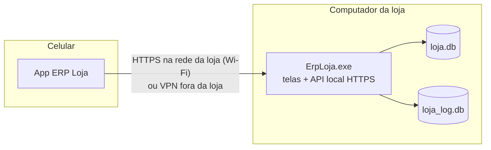

# App para celular — estudo de viabilidade e desenho

> **Situação: proposta (nada implementado).** Pedido do product owner: "pense (apenas pense) em como seria para
> implementar um app disso … seria 4 coisas: o exe, os 2 bancos e o app pra celular". Este documento registra o
> raciocínio, a arquitetura recomendada, a segurança, o escopo e as etapas. Decisão em [ADR-0022](adr/0022-app-celular-api-local.md).

## 1. As quatro peças

| Peça | O que é | Muda algo hoje? |
|---|---|---|
| `ErpLoja.exe` | O sistema de sempre, **mais** um servidor de API local (desligado por padrão) que o app usa | Sim: ganha o módulo "Servidor do app" |
| `loja.db` | Banco de dados da loja | Não: continua sendo aberto **só pelo exe** |
| `loja_log.db` | Log de atividades com cadeia de integridade | Não: acessos do app entram no log com o aparelho identificado |
| App do celular | Aplicativo Android (e iOS, se desejado) | Novo |

**Regra central: o celular nunca abre os arquivos `.db`.** SQLite não foi feito para ser compartilhado pela rede
(compartilhamento de pasta corrompe o banco quando dois gravam ao mesmo tempo) e entregar o arquivo ao celular
exporia todos os dados da loja, senhas (hash) e segredos. O celular conversa com o exe; o exe conversa com o banco,
com as **mesmas regras de negócio, validações, permissões e log** das telas do computador.

## 2. Arquitetura recomendada

### 2.1 Servidor dentro do exe
- O exe passa a hospedar uma API HTTP pequena (ASP.NET Core Kestrel embutido no mesmo arquivo único), ligada em
  Configurações > **Servidor do app** (porta, liberar/revogar aparelhos). Desligada por padrão.
- Dois modos: **junto com as telas** (o servidor vive enquanto o ERP estiver aberto no computador do caixa) ou
  **serviço** (`ErpLoja.exe --servidor`, registrado como serviço do Windows num computador que fica ligado).
- Todas as gravações passam pelas classes que as telas já usam (`Data/*`: Vendas, Pedidos, Estoque, Financeiro…),
  numa fila única: o SQLite aceita um gravador por vez e a fila evita "banco ocupado".
- Pré-requisito técnico: separar a camada de dados das telas (projeto `ErpLoja.Core` sem WinForms). Hoje algumas
  regras chamam utilitários de interface (ex.: `Ui.Txt`, mensagens); a separação é um refactor mecânico, coberto pela
  bateria de testes atual.

### 2.2 Fora da loja
Não abrir porta no roteador (expor o computador da loja na internet é o maior risco). Duas opções seguras:
1. **VPN** (Tailscale/WireGuard): o celular entra na rede da loja de forma criptografada; nada muda no exe. Recomendada.
2. **Relé na nuvem** (fase futura): o exe abre conexão de saída para um serviço intermediário; exige servidor pago,
   contas e termo de privacidade (LGPD). Só vale se houver muitos usuários externos.

### 2.3 Tecnologia do app
| Opção | A favor | Contra | Veredito |
|---|---|---|---|
| **.NET MAUI** | Mesmo C# do ERP: reaproveita `Formatos`, `RegrasCadastro`, modelos e a validação de campos; Android e iOS | App maior; ferramental mais pesado | **Recomendado** |
| Flutter | Interface fluida, comunidade grande | Outra linguagem (Dart): regras e validações duplicadas | Alternativa |
| PWA (site servido pelo exe) | Sem loja de apps, atualiza junto com o exe | Câmera e funcionamento offline exigem HTTPS com certificado confiável pelo celular — difícil com certificado próprio na rede local | Não recomendado |

Distribuição: Android por APK instalado direto ou pela Play Store (faixa interna/fechada); iOS exige conta de
desenvolvedor Apple (anual) e TestFlight/App Store.

## 3. Segurança (OWASP API Security Top 10)

| Risco | Medida |
|---|---|
| Autenticação | **Pareamento por QR code**: Configurações mostra um QR com endereço, porta, impressão digital do certificado e um código de uso único (vale 5 min). O app gera um par de chaves do aparelho; o administrador vê e aprova o aparelho. Depois, login com o **mesmo usuário e senha** do ERP, com bloqueio após 5 erros (`ControleDeAcesso`). |
| Transporte | HTTPS sempre, com certificado próprio gerado pelo exe e **fixado** no app pela impressão digital do QR (sem aceitar qualquer certificado). |
| Sessão | Token curto (15 min) renovado por token do aparelho; aparelho revogável a qualquer momento; troca de senha derruba as sessões. |
| Autorização por objeto/função (BOLA/BFLA) | Cada chamada passa pelas mesmas checagens das telas (`Permissoes`, e futuramente permissões por tela/ação); nunca confiar em id vindo do app sem conferir dono e perfil. |
| Exposição de dados | Respostas com só os campos necessários (DTOs), nada de senhas, segredos, chaves ou dados de outros módulos. |
| Consumo de recursos | Limite de requisições por aparelho, tamanho máximo de corpo, paginação obrigatória nas listas. |
| Injeção | Sem SQL vindo do app: só operações de negócio com parâmetros validados pelos mesmos `Formatos`. |
| Inventário/versões | API versionada (`/api/v1`); o app informa sua versão e o exe recusa versões incompatíveis com mensagem clara. |
| Log | Cada chamada vira registro no `loja_log.db` (usuário, aparelho, IP, ação), na mesma cadeia de integridade. |
| Celular perdido | Revogar o aparelho no ERP; dados guardados no celular cifrados (Keystore/Keychain) e apagados ao revogar. |

## 4. Funcionalidades (por prioridade)

| Fase | Funcionalidade | Quem usa | Por que no celular |
|---|---|---|---|
| 1 | Consulta de produto, preço e estoque pela **câmera** (código de barras) | Vendedor, estoquista | Atender no salão sem ir ao caixa |
| 1 | **Inventário**: contar lendo códigos e enviar a contagem (gera o ajuste com aprovação no ERP) | Estoquista | Hoje exige papel ou levar o notebook |
| 1 | Painel do dono: vendas do dia, contas vencidas, OS atrasadas | Gerente | Acompanhar de longe (via VPN) |
| 2 | Orçamentos e pedidos de venda fora do balcão (visita ao cliente) | Vendedor externo | Funciona offline e envia ao voltar |
| 2 | Ordens de serviço: ver etapa, mudar etapa, foto da arte/peça, avisar atraso | Produção | Atualização na hora em que acontece |
| 2 | Entregas/fretes: motorista confirma entrega com foto e nome de quem recebeu | Motorista | Comprovante sem papel |
| 3 | Cobrança: lista de devedores, registrar contato e promessa de pagamento | Financeiro | Cobrança por telefone/WhatsApp do próprio celular |
| 3 | Assistente de dúvidas (IA) | Todos | Mesmo assistente do ERP, mesmas regras |

Fora de escopo no celular: PDV/TEF (exige impressora fiscal e pinpad), notas fiscais, configurações, usuários e
cobrança bancária (arquivos CNAB) — continuam no computador.

## 5. Funcionamento sem rede (offline)
- O app guarda um catálogo resumido (produtos, preços, clientes ativos) para consulta e orçamento offline.
- Operações feitas offline entram numa fila com **chave de idempotência** (o reenvio nunca duplica um pedido).
- O exe é a fonte da verdade: ao sincronizar, revalida estoque, preço e permissões; o que não puder ser aceito volta
  ao app como pendência explicada (ex.: "preço mudou de R$ 10,00 para R$ 12,00 — confirmar?").
- Nada que movimente dinheiro ou estoque é dado como concluído no celular antes da confirmação do exe.

## 6. Impactos no sistema atual
- Migração nova: tabelas `aparelhos` (aparelho, usuário, chave pública, aprovado por, revogado em, último acesso) e
  `fila_app` (idempotência).
- Configurações: grupo "Servidor do app" (ligado, porta, QR de pareamento, lista de aparelhos).
- Firewall do Windows: liberar a porta só na rede privada (o exe pode pedir isso na primeira ativação).
- Backup e restauração continuam iguais (o celular não guarda dados de que o ERP dependa).

## 7. Etapas e esforço estimado

| Etapa | Entrega | Esforço |
|---|---|---|
| 0 | Separar `ErpLoja.Core` (dados e regras sem WinForms) | 1–2 semanas |
| 1 | API local + pareamento + log + testes de segurança | 2–3 semanas |
| 2 | App fase 1 (consulta, inventário, painel) Android | 3–4 semanas |
| 3 | App fase 2 (orçamentos offline, OS, entregas) | 4–6 semanas |
| 4 | iOS, publicação nas lojas, relé na nuvem (opcional) | conforme demanda |

## 8. Riscos

| Risco | Mitigação |
|---|---|
| Computador da loja desligado = app sem servidor | Modo serviço do Windows num computador que fica ligado; app avisa "servidor fora do ar" e trabalha offline |
| Wi-Fi da loja aberto a clientes | API só aceita aparelhos pareados e aprovados, por HTTPS fixado; recomendar rede separada para clientes |
| Versões diferentes de exe e app | API versionada e checagem de compatibilidade na conexão |
| Custo de manter duas interfaces | Regras ficam só no Core; o app é fino (mostra e coleta dados) |
